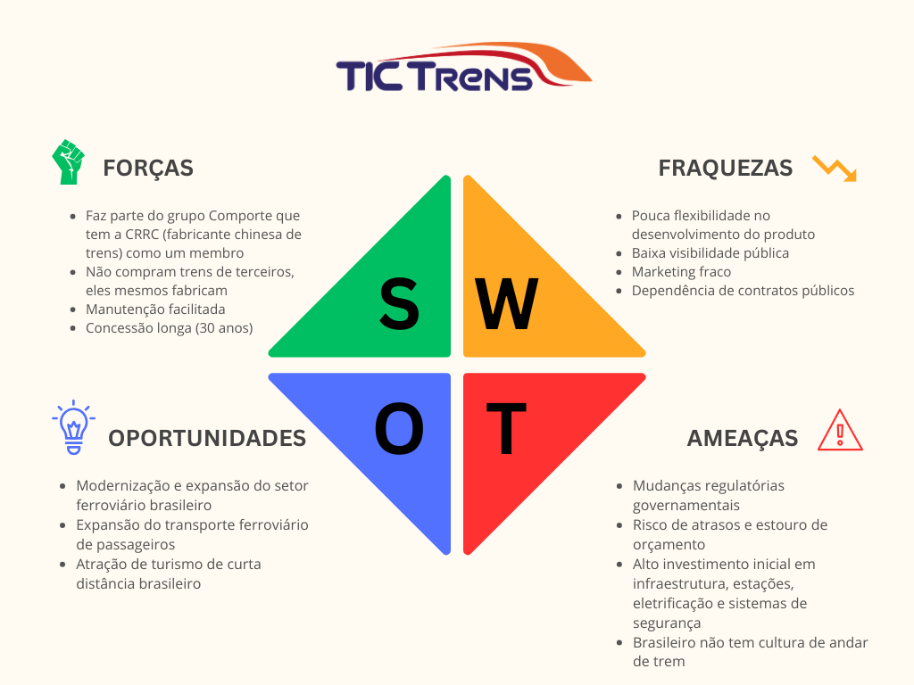

# Documentação IoTDoc - Módulo 4 - Inteli

**_Os trechos em itálico servem apenas como guia para o preenchimento da seção. Por esse motivo, não devem fazer parte da documentação final_**

## Nome do Grupo

#### Nomes dos integrantes do grupo

## Sumário

[1. Introdução](#c1)

[2. Metodologia](#c2)

[3. Desenvolvimento e Resultados](#c3)

[4. Conclusões e Recomendações](#c4)

[5. Referências](#c5)

 

# 1. Introdução (sprint 1)

_Apresente de forma sucinta o parceiro de negócio, seu porte, local, área de atuação e posicionamento no mercado. Maiores detalhes deverão ser descritos na seção 4. Descreva resumidamente o problema a ser resolvido (sem ainda mencionar a solução)._

## 1.1 Objetivos

_Descreva os objetivos gerais e específicos do seu parceiro de negócios, sem entrar em méritos técnicos ou especificações de tecnologia. Aqui importa o objetivo em si, não os meios para se chegar até lá._

## 1.2 Proposta da solução

_Descreva resumidamente sua proposta de solução (em alto nível) e como essa solução pretende resolver o problema, atendendo os objetivos listados na seção anterior._

## 1.3 Justificativa

_Faça uma breve defesa de sua proposta de solução, escreva sobre seus potenciais, seus benefícios e como ela se diferencia._

# 2. Metodologia (sprint 3)

_Descreva as etapas da metodologia RM-ODP que foram utilizadas para o desenvolvimento, citando o referencial teórico. Você deve apenas enunciar os métodos, sem dizer ainda como ele foi aplicado e quais resultados obtidos._

# 3. Desenvolvimento e Resultados 

## 3.1. Domínio de Fundamentos de Negócio

_Link para os templates de negócios: https://drive.google.com/drive/folders/1lTqisJ_gxxtc5J5aXM8ula2kQ4MsII_M?usp=sharing_

### 3.1.1. Contexto da Indústria 

O setor de concessões de transporte ferroviário passa por uma profunda transformação no Brasil com a migração do modelo estatal para o privado. Este novo cenário, onde a TIC Trens atua, é marcado por alta competição em licitações e forte pressão regulatória do governo. O sucesso agora depende da capacidade de garantir eficiência e segurança operacional, justificando a necessidade de soluções de controle como este projeto.

**Principais Players (Rivais Corporativos)**

No mercado de operação ferroviária, a "rivalidade" não se dá pela disputa diária do mesmo passageiro, pois cada linha é um monopólio geográfico. A competição estratégica ocorre no nível corporativo, pela **disputa de novas licitações de concessão**. Os principais rivais da TIC Trens são os grandes grupos que competem nos leilões do governo, como a **ViaMobilidade** (parte do grupo CCR, opera as linhas 8 e 9 em SP), o **Grupo Invepar** (operador do MetrôRio) e a **CCR Metrô Bahia**. Essas empresas competem por capital, por fornecedores estratégicos (como fabricantes de trens) e por mão de obra técnica, estabelecendo os benchmarks de performance (segurança, pontualidade) que o governo usa para fiscalizar todas as operadoras.

**Modelos de Negócio**

O modelo de negócio é o de **Concessão de Serviço Público**. O grupo privado vence um leilão para construir/reformar, operar e manter (modelo "BOT" ou similar) uma linha por um longo período (ex: 20-30 anos). A receita vem da **tarifa** paga pelo passageiro (muitas vezes complementada por subsídios do governo) e de **receitas não-tarifárias** (aluguel de lojas nas estações, publicidade). O sucesso do negócio depende estritamente do cumprimento de indicadores de desempenho (KPIs) contratuais, onde falhas de segurança ou operação (como as que seu projeto visa evitar) podem gerar multas milionárias e afetar a viabilidade da concessão.

**Tendências**

A principal tendência do setor é a **Digitalização da Operação** para aumento de eficiência e segurança. Isso inclui a implementação de sistemas de **Manutenção Preditiva**, onde sensores (IoT) em trilhos e trens antecipam falhas antes que elas parem a operação. Outra forte tendência é a **Gestão de Ativos (Asset Management)**, que é exatamente onde seu projeto de controle de acesso se encaixa, garantindo o rastreamento e a segurança de infraestruturas críticas. Por fim, há um foco crescente na **Experiência do Passageiro (Passenger Experience)**, com investimentos em informação em tempo real, métodos de pagamento digitais (como PIX e contactless) e melhoria da segurança nas estações e trilhos, esta última também relacionada ao seu desafio de detecção de invasão.

**Conclusão**

Conclui-se que o setor é um ambiente de alta pressão, onde o modelo de negócio punitivo (baseado em KPIs e multas) e a rivalidade estratégica (por reputação e performance) se encontram. A tendência da digitalização, especialmente a gestão de ativos e a manutenção preditiva, não é um luxo, mas uma necessidade de sobrevivência e competitividade. É neste nexo de segurança rigorosa e necessidade de eficiência que o projeto de controle de acesso se torna uma alavanca estratégica para a TIC Trens, garantindo conformidade e protegendo a empresa das penalidades contratuais.

#### Análise das 5 Forças de Porter

A análise das 5 Forças de Porter ajuda a mapear o ambiente competitivo das concessões ferroviárias. Este modelo avalia a intensidade das pressões que a TIC Trens enfrenta de concorrentes, fornecedores, clientes e substitutos, identificando os principais desafios para o seu sucesso operacional e rentabilidade.

**1\. Ameaça de Novos Entrantes: Baixa**

*   **Por quê:** As barreiras de entrada são altíssimas. A entrada no setor exige a vitória em uma licitação governamental, que é um processo longo e complexo. Além disso, o investimento de capital (CAPEX) necessário é astronômico, envolvendo a compra de trens (que custam milhões cada), modernização de sistemas de sinalização, estações e contratação de mão de obra altamente especializada. Não é um mercado em que uma nova empresa pode "decidir" entrar; ela precisa ser um consórcio com enorme capacidade financeira e técnica.
    

**2\. Poder de Barganha dos Fornecedores: Alto**

*   **Por quê:** O setor depende de um número muito restrito de fornecedores globais e especializados. Fabricantes de trens (como Alstom, Siemens, Hitachi) formam um oligopólio e possuem alto poder de negociação nos preços e prazos de entrega. O mesmo vale para fornecedores de sistemas de sinalização (como o CBTC) e equipamentos de manutenção pesada. A TIC Trens terá poucas alternativas, tornando-se dependente desses fornecedores para manter a operação e cumprir seus investimentos contratuais.
    

**3\. Poder de Barganha dos Clientes: Baixo (Passageiro) / Altíssimo (Governo)**

*   **Análise:** É preciso dividir o "cliente" em dois:
    
    *   **O Passageiro Individual (Cliente Final):** Tem poder de barganha **baixo**. A linha de trem opera como um monopólio natural em sua rota. O passageiro que precisa se deslocar pela área da Linha 7 não pode "escolher" um trem concorrente; suas únicas alternativas são os _substitutos_.
        
    *   **O Poder Concedente (Governo/Agência Reguladora):** Este é o "cliente" real do contrato e tem poder de barganha **altíssimo**. O governo (e a agência reguladora, como a ARTESP) fiscaliza o contrato de concessão e pode aplicar multas severas por descumprimento de KPIs (pontualidade, segurança, limpeza). Em casos extremos de má performance, pode até mesmo cassar a concessão.
        

**4\. Ameaça de Produtos ou Serviços Substitutos: Alta**

*   **Por quê:** Esta é a força que você mencionou e é, de fato, a principal concorrência pelo passageiro.
    
    *   **Para a Linha 7 (Urbana):** Os substitutos são o transporte rodoviário (ônibus municipais/intermunicipais) e o transporte individual (carros, motos, aplicativos como Uber). A ameaça é média, pois o trem ganha em tempo (não pega trânsito) e custo.
        
    *   **Para o Trem SP-Campinas (Média Distância):** A ameaça é **altíssima**. O trem competirá diretamente com empresas de ônibus executivos (ex: **Viação Cometa, Buser**), com o conforto do carro particular e com a flexibilidade dos aplicativos. O sucesso do trem dependerá de uma combinação de preço, tempo total de viagem (incluindo o "porta-a-porta") e conforto muito superior aos substitutos.
        

**5\. Rivalidade entre os Concorrentes: Média**

*   **Por quê:** Como explicado no item 1, a rivalidade não se dá pela disputa do passageiro no dia-a-dia. A rivalidade é **feroz** em três frentes estratégicas:
    
    1.  **Disputa por Novas Concessões:** Os grandes grupos (CCR, Invepar, a própria TIC Trens) competem agressivamente nos leilões de privatização de novas linhas.
        
    2.  **Disputa por Recursos:** Competição por mão de obra técnica qualificada (que é escassa) e pela atenção dos fornecedores limitados.
        
    3.  **Benchmarking:** Competição por reputação e performance. Ser vista como a "melhor operadora" perante o governo e a opinião pública é vital para garantir a renovação e a vitória em futuros leilões.
        

A análise das 5 Forças revela que o setor de concessões ferroviárias é **estruturalmente desafiador**. A TIC Trens opera "pressionada" por três lados: o **Poder de Barganha dos Fornecedores** (alto), o **Poder de Barganha do Cliente-Chave (Governo)** (altíssimo) e a **Ameaça de Substitutos** (alta). A rentabilidade da empresa não virá da ausência de concorrência (pois os substitutos são fortes), mas sim da sua capacidade de ser **extremamente eficiente** e **impecável no cumprimento do contrato** (para evitar multas do Governo). Portanto, investimentos em tecnologia de controle e segurança, como este projeto, não são diferenciais competitivos, mas sim **requisitos essenciais de sobrevivência** para mitigar as forças mais poderosas que atuam contra a empresa.

### 3.1.2. Análise SWOT	

A análise SWOT é um documento essencial para todo projeto, isso se deve por nele apresentar fatores internos(forças e fraquezas) e externos(ameaças e oportunidades), esses que vão mostrar a situação clara da empresa, facilitando a tomada de decisão e rumo do produto.

Imagem 03: Análsie SWOT

Fonte: Material produzido pelo Time DedSec, 2025.

 

A análise SWOT evidencia que a TicTrens possui diferenciais estratégicos importantes, sendo parte do Grupo Comporte e contando com a CRRC como fabricante de seus trens. Essa estrutura garante o benefício de não comprar trens de terceiros, conferindo uma vantagem competitiva de controle e custo, além da facilidade na manutenção e a segurança de uma concessão longa de 30 anos.

Essas forças se alinham perfeitamente às oportunidades geradas pela modernização e expansão do setor ferroviário brasileiro e pelo crescente potencial de expansão do transporte de passageiros e turismo de curta distância, criando um cenário promissor para o crescimento.

No entanto, a pouca flexibilidade no desenvolvimento do produto, a baixa visibilidade pública e o marketing fraco representam pontos de atenção internos que precisam ser urgentemente endereçados para maximizar a captura das oportunidades.

Além disso, as ameaças de mudanças regulatórias governamentais, o risco de atrasos e estouro de orçamento devido ao alto investimento inicial em infraestrutura e o desafio cultural de o brasileiro não ter o costume de andar de trem destacam a necessidade de estratégias que combinem eficiência operacional, gestão rigorosa de projetos e campanhas para favorecer à cultura ferroviária.

Dessa forma, a empresa deve direcionar esforços para aproveitar a capacidade de produção própria e a base da concessão, enquanto mitiga ativamente os riscos de custos e fortalece sua imagem e penetração no mercado, superando as barreiras culturais e regulatórias.

### 3.1.3. Descrição da Solução a ser Desenvolvida (sprint 1)	

#### 3.1.3.1 Qual é o problema a ser resolvido

#### 3.1.3.2 Qual a solução proposta (visão de negócios)

#### 3.1.3.3 Como a solução proposta deverá ser utilizada

#### 3.1.3.4 Quais os benefícios trazidos pela solução proposta

#### 3.1.3.5 Qual será o critério de sucesso e qual medida será utilizada para o avaliar
	
### 3.1.4. Value Proposition Canvas (sprint 1)	

_O Canvas da proposta de valor deve ser feito considerando a solução que vocês estão desenvolvendo. Usar o template disponível no drive da turma._     

### 3.1.5. Matriz de Riscos (sprint 1)	

_A Matriz de Risco deve ser desenhada considerando o projeto que os alunos estão criando. Deve ser entregue no template disponível no drive da turma. Os alunos devem enumerar os riscos, distribuí-los na matriz e justificar suas decisões._     

### 3.1.6. Política de Privacidade de acordo com a LGPD  

&nbsp;&nbsp;&nbsp;&nbsp;A Política de Privacidade é um documento essencial no contexto de colaboração entre o grupo DedSec — o Grupo 04 do 4º módulo de 2025 da Turma 18 do Inteli — e a Tic Trens, considerando a necessidade de coleta e análise de dados. Este documento assegura aos usuários, colaboradores e parceiros, enquanto titulares dos dados, que as informações pessoais são tratadas com respeito, responsabilidade e em conformidade com a Lei nº 13.709/2018 — Lei Geral de Proteção de Dados Pessoais (LGPD). (Arquia, 2025)[1](#foot1)  

#### 3.1.6.1 Informações gerais sobre a empresa / organização  

&nbsp;&nbsp;&nbsp;&nbsp;O Instituto de Tecnologia e Liderança (Inteli), pessoa jurídica de direito privado, está localizado na Av. Prof. Almeida Prado, 520 - Butantã, São Paulo - SP, 05508-070, e inscrito no CNPJ/MF sob o nº 28.226.170/0001-08.  
&nbsp;&nbsp;&nbsp;&nbsp;Em parceria com a Tic Trens, o Inteli reforça seu compromisso com a proteção de dados pessoais. A colaboração com o time DedSec no projeto de gerenciamento de acessos utiliza plataformas e conexões para coletar e tratar dados de forma responsável, garantindo total conformidade com a legislação vigente.  

#### 3.1.6.2 Informações sobre o tratamento de dados  

&nbsp;&nbsp;&nbsp;&nbsp;O tratamento de dados coletados pelo sistema e integrados à Ubidots tem como principal objetivo monitorar e validar acessos físicos a áreas técnicas, garantindo segurança operacional e integridade das informações.  
&nbsp;&nbsp;&nbsp;&nbsp;O tratamento baseia-se nas hipóteses legais de **execução de contrato** e **legítimo interesse** (art. 7º, incisos V e IX da LGPD).  

&nbsp;&nbsp;&nbsp;&nbsp;Os dados são tratados conforme os seguintes princípios:  
- **Finalidade**: os dados têm propósitos legítimos, claros e específicos, como autenticação, registro de acessos e geração de relatórios de conformidade.  
- **Adequação**: o tratamento é compatível com as necessidades e objetivos do projeto.  
- **Necessidade**: apenas os dados estritamente necessários são coletados e transmitidos à Ubidots.  
- **Segurança**: medidas técnicas e administrativas são aplicadas para proteger as informações contra acessos não autorizados.  

#### 3.1.6.3 Quais são os dados coletados  

&nbsp;&nbsp;&nbsp;&nbsp;Os dados coletados englobam informações fornecidas diretamente pelos usuários e dados técnicos obtidos automaticamente por dispositivos IoT. Entre eles, estão:  
- **Dados pessoais identificáveis**: nome, identificação corporativa (RFID) e credenciais de acesso.  
- **Dados técnicos e operacionais**: tipo de dispositivo, sistema operacional, localização aproximada (via IP), registros de logs e _timestamps_ de acesso.  
- **Dados provenientes de dispositivos IoT**: identificadores únicos, leituras de sensores e eventos de autenticação coletados pela Ubidots para análise em tempo real.  

&nbsp;&nbsp;&nbsp;&nbsp;Caso sejam tratados **dados sensíveis**, como informações relacionadas à saúde ocupacional ou segurança do trabalho, estes recebem tratamento diferenciado, com camadas adicionais de segurança, controle de acesso e anonimização, conforme o art. 11 da LGPD.  

#### 3.1.6.4 Onde os dados são coletados  

&nbsp;&nbsp;&nbsp;&nbsp;Os dados são coletados por meio da **integração entre os dispositivos IoT e a plataforma Ubidots**, que atua como um ponto central de coleta e visualização.  
&nbsp;&nbsp;&nbsp;&nbsp;A comunicação entre os dispositivos (ex: módulos ESP32 com RFID) e a Ubidots ocorre via protocolos MQTT ou HTTP, com autenticação de token e criptografia, garantindo a integridade e confidencialidade das transmissões.  

#### 3.1.6.5 Para quais finalidades os dados serão utilizados  

&nbsp;&nbsp;&nbsp;&nbsp;Os dados coletados têm as seguintes finalidades:  
1. **Monitoramento e controle de acesso**: validar autenticações e registrar entradas em áreas técnicas.  
2. **Gestão de segurança**: identificar tentativas de acesso indevido e emitir alertas em tempo real.  
3. **Auditoria e conformidade**: gerar relatórios de histórico e rastreabilidade para gestores.  
4. **Visualização analítica**: exibir métricas de uso e dados de sensores por meio dos dashboards da Ubidots.  

#### 3.1.6.6 Onde os dados ficam armazenados  

&nbsp;&nbsp;&nbsp;&nbsp;Os dados são armazenados de forma redundante e segura nos **servidores da Ubidots**, que utilizam infraestrutura em nuvem com alto padrão de disponibilidade e segurança.  
&nbsp;&nbsp;&nbsp;&nbsp;A plataforma aplica **criptografia em repouso e em trânsito**, controle de acesso por token e autenticação multifatorial para usuários administrativos. Além disso, a Ubidots realiza auditorias de segurança periódicas e segue conformidades reconhecidas internacionalmente, como **ISO 27001** e **SOC 2**.  

#### 3.1.6.7 Qual o período de armazenamento dos dados (retenção)  

&nbsp;&nbsp;&nbsp;&nbsp;O período padrão de retenção dos dados é de **três meses**, podendo variar conforme as necessidades do parceiro. Após o prazo, os dados são excluídos ou anonimizados automaticamente na plataforma Ubidots, conforme sua política de retenção.  

#### 3.1.6.8 Uso de *cookies* e/ou tecnologias semelhantes  

&nbsp;&nbsp;&nbsp;&nbsp;A plataforma web de visualização pode utilizar *cookies* essenciais para manter sessões e preferências de usuário. Esses *cookies* são necessários para o funcionamento adequado da interface e podem ser gerenciados ou desativados pelo navegador do usuário.  

#### 3.1.6.9 Com quem esses dados são compartilhados  

&nbsp;&nbsp;&nbsp;&nbsp;Os dados são compartilhados com a **Tic Trens**, o **Inteli** e a **Ubidots**, responsável pela hospedagem e visualização dos dados IoT. Todos os parceiros seguem políticas internas de segurança e privacidade alinhadas à LGPD.  

#### 3.1.6.10 Informações sobre medidas de segurança adotadas  

&nbsp;&nbsp;&nbsp;&nbsp;O sistema implementa medidas de segurança abrangentes, incluindo:  
- Criptografia ponta a ponta nas comunicações entre dispositivos e servidor.  
- Controle de acesso baseado em papéis (RBAC) e autenticação multifatorial.  
- Segregação de ambientes de desenvolvimento, teste e produção.  
- Anonimização e pseudonimização de dados sensíveis.  
- Logs de auditoria contínuos na Ubidots e no backend do projeto.  

#### 3.1.6.11 Direitos dos titulares de dados  

&nbsp;&nbsp;&nbsp;&nbsp;Os titulares de dados podem exercer seus direitos previstos nos artigos 18 e 19 da LGPD, incluindo:  
1. Solicitar a exclusão ou anonimização de seus dados pessoais.  
2. Corrigir informações incorretas ou desatualizadas.  
3. Solicitar uma cópia de todos os dados tratados.  

&nbsp;&nbsp;&nbsp;&nbsp;As solicitações devem ser enviadas para [parcerias@inteli.edu.br](mailto:parcerias@inteli.edu.br) e serão atendidas em até **15 dias**, conforme a legislação vigente.  

#### 3.1.6.12 Contato do Encarregado de Proteção de Dados (DPO)  

&nbsp;&nbsp;&nbsp;&nbsp;O Encarregado de Proteção de Dados (DPO) é responsável por supervisionar as práticas relacionadas ao tratamento de dados pessoais no projeto. O contato pode ser realizado pelo e-mail [dpo@inteli.edu.br](mailto:dpo@inteli.edu.br), informando o motivo da solicitação e os dados necessários para identificação.  

&nbsp;&nbsp;&nbsp;&nbsp;O grupo DedSec reafirma seu compromisso com a **transparência**, **segurança da informação** e **conformidade legal**, garantindo que todas as práticas de tratamento de dados — tanto na infraestrutura interna quanto na Ubidots — estejam alinhadas à LGPD e às diretrizes éticas do Inteli.

### 3.1.7. Bill of Material (BOM) (sprint 1)
_BOM (Bill of Material) pode ser definido como uma lista completa de materiais, que detalha todos os itens necessários para construir, fabricar ou reparar um produto. Deve-se preencher o template fornecido.

## 3.2. Domínio de Fundamentos de Experiência de Usuário 

### 3.2.1. Personas (sprint 1)	

_Coloque aqui suas Personas:_
- _Representação fictícia do público-alvo._
- _Baseada em dados reais e pesquisas._
- _Humaniza o público, facilitando decisões centradas no usuário._
- _Trabalhar na criação de pelo menos uma Persona_

### 3.2.2. Jornada do Usuário e Storyboard (sprint 2)	

_Coloque aqui seu Mapa de Jornada do Usuário:_
- _Ferramenta visual da sequência de interações do usuário._
- _Retrata sentimentos, obstáculos e satisfação ao longo de um processo._
- _Identifica oportunidades de melhoria na experiência._
- _Fazer pelo menos um mapa de jornada do usuário_

_Coloque aqui seu Storyboard:_
- _Ilustração sequencial da interação do usuário com a solução._
- _Enfatiza fluxo, interações e narrativa visual._
- _Destaca pontos de atrito ou oportunidades na experiência._
- _Criar ao menos um storyboard._

## 3.3. Solução Técnica	

_Nesta seção, detalhe a especificação da solução, de acordo com o disposto nas subseções._

### 3.3.1. Requisitos Funcionais (sprint 1)	

_Descreva quais são os requisitos funcionais e sua relação com as demandas e problemas de negócios (visão de funcionalidades). Evolua estes requisitos conforme o desenvolvimento do projeto._

_Atente-se as regras de negócios. Caso necessário, as aponte nos cenários dos requisitos funcionais._

| **RF#** | **Descrição** | **Regra de negócio** | 
|----------|----------|----------|
|RF01|Ex. O dispositivo deve permitir acionamento por botão liga e desliga|Ex. A solução deve funcionar apenas durante seu uso por operadores|
|RF02|Preencha aqui seus requisitos|Preencha aqui as regras de negócio relacionadas|

### 3.3.2. Requisitos Não Funcionais (sprint 2)	

_Descreva quais são os requisitos não funcionais e sua relação com aspectos de qualidade seguindo a norma ISO25010 (visão de aspectos de qualidade). Evolua estes requisitos conforme o desenvolvimento do projeto._

| **RNF#** | **Descrição** | **Aspecto de qualidade** | 
|----------|----------|----------|
|RNF01|Ex. O painel dashboard deve estar disponível 99% do tempo|Ex. Disponibilidade|
|RNF02|Preencha aqui seus requisitos|Preencha aqui o aspecto de qualidade|

### 3.3.3. Arquitetura da Solução (sprint 3)

_Vídeo de explicação sobre a arquitetura da solução: (coloque aqui o link do vídeo)_

_Descreva a arquitetura técnica da solução de forma detalhada (visão de arquitetura).

Justifique como a arquitetura suporta os requisitos funcionais e não funcionais.

O diagrama de arquitetura deve:_
- _Mostrar microcontroladores, incluindo descrições de sua função no sistema (por exemplo: "Irá processar o sinal dos sensores a cada X minutos")_
- _Mostrar sensores, incluindo descrição de função e especificações técnicas do tipo de informação que será coletada_
- _Mostrar apresentadores de informação (displays), incluindo descrição de que tipo de informação será apresentada (por exemplo, "Mostrar temperatura dos sensores")_
- _Mostrar atuadores, caso existam na solução, incluindo descrições do que irão acionar (por exemplo, "Ligar motor de irrigação durante x minutos")_
- _Mostrar o broker MQTT e o dashboard que é a interface do usuário_
- _Mostrar ligações entre os elementos (com fio ou sem fio) – incluindo conexões com sensores e atuadores, conexão com WiFi, entre outros_

### 3.3.4. Arquitetura do Protótipo(sprint 4)	

_Vídeo de explicação sobre a arquitetura do protótipo físico: (coloque aqui o link do vídeo)_

_Descreva as tecnologias utilizadas de forma detalhada (visão de tecnologia).

Descreva a arquitetura usando um diagrama de blocos similar à visão anterior, porém especificando as tecnologias utilizadas. O diagrama de arquitetura deve:_
- _Mostrar microcontroladores, incluindo descrições de sua função no sistema (por exemplo: "Irá processar o sinal dos sensores a cada X minutos")_
- _Mostrar sensores, incluindo descrição de função e especificações técnicas do tipo de informação que será coletada_
- _Mostrar apresentadores de informação (displays), incluindo descrição de que tipo de informação será apresentada (por exemplo, "Mostrar temperatura dos sensores")_
- _Mostrar atuadores, caso existam na solução, incluindo descrições do que irão acionar (por exemplo, "Ligar motor de irrigação durante x minutos")_
- _Mostrar o broker MQTT e o dashboard que é a interface do usuário_
- _Mostrar ligações entre os elementos (com fio ou sem fio) – incluindo conexões com sensores e atuadores, conexão com WiFi, entre outros._
_Faça uma tabela dos possíveis componentes utilizados. Todos os componentes devem estar presentes na arquitetura._

| **Componente** | **Descrição** | **Tipo** | 
|----------|----------|----------|
|E.g. ESP32 WROOM 32 Devkit|E.g. Trata-se de um microcontrolador amplamente usado na indústria e em projetos educacionais, que possui interfaces mais amigáveis para conexão de componentes diversos...|E.g. Microcontrolador|
|E.g. sensor XPTO|E.g. Este sensor mede o sinal de XYZ em unidades q/s, e possui tolerância de abcd...|E.g. Sensor|

### 3.3.5. Arquitetura Refinada da Solução (sprint 5)	

_Descreva a revisão da arquitetura técnica da solução de forma detalhada (visão de arquitetura).  

Justifique como a arquitetura suporta os requisitos funcionais e não funcionais.  

A revisão deverá incluir comentários sobre cada ponto levantado, mostrando como os ajustes foram realizados, além da descrição da arquitetura revisada._

## 3.4. Resultados	

_Nesta seção, detalhe os resultados obtidos com a implementação, de acordo com o disposto nas subseções._

### 3.4.1.Protótipo Inicial do Projeto usando o Simulador Wokwi (sprint 1)

_Preencha aqui o link para o protótipo inicial no Wokwi_

_Abaixo você deve registrar diversas situações de teste, indicando exemplos de leitura (entrada) e escrita (saída) apresentadas pelo seu sistema no simulador. Estes registros serão utilizados para testar seus componentes, portanto, descreva várias situações, incluindo não apenas casos de sucesso, mas também de possíveis falhas nas leituras de entradas e saídas.  
Siga as nomenclaturas e convenções já utilizadas anteriormente, e não se esqueça dos alinhamentos de negócios e experiência do usuário para pensar em situações representativas. Inclua figuras do simulador e descreva os testes realizados para ilustrar o funcionamento do protótipo simulado. A tabela a seguir serve como exemplo._

**#** | **Bloco** | **Componente de entrada** | **Leitura da entrada** | **Componente de saída** | **Leitura da saída** | **Descrição**
|----------|----------|----------|----------|----------|----------|----------|
|01|ex. medidor de umidade relativa do ar|ex. “sensor de umidade XPTO”| < 100 | ex. led amarelo | piscante em intervalo de 1s | quando a umidade está baixa, o led amarelo pisca

### 3.4.2. Protótipo Físico do Projeto (offline) (sprint 2)	

_Aqui você deve registrar diversas situações de teste, indicando exemplos de leitura (entrada) e escrita (saída) apresentadas pelo seu sistema físico. Estes registros serão utilizados para testar seus componentes, portanto, descreva várias situações, incluindo não apenas casos de sucesso, mas também de possíveis falhas nas leituras de entradas e saídas.  
Siga as nomenclaturas e convenções já utilizadas anteriormente, e não se esqueça dos alinhamentos de negócios e experiência do usuário para pensar em situações representativas. Inclua figuras do protótipo físico e descrições dos testes realizados para ilustrar o funcionamento do protótipo. A tabela a seguir serve como exemplo._

**#** | **Descrição** | **Pré-condição** | **Procedimento de teste** | **Pós-condição/Resultado esperado** | **Observações** (opcional)
|----------|----------|----------|----------|----------|----------|
|01|ex. Verificação de conexão de rede bem-sucedida. | ex. O dispositivo está desligado.| ex. Ligue o dispositivo, aguarde alguns segundos e verifique se ele estabelece uma conexão bem-sucedida com a rede Wi-Fi. | ex. O LED verde indicador de conexão acende de forma contínua, sinalizando uma conexão bem-sucedida à rede. |

### 3.4.3. Protótipo do Projeto com MQTT e I2C (sprint 3)	

_Aqui você deve registrar diversas situações de uso de seu sistema como um todo, indicando exemplos de ação do usuário e resposta do sistema, apontando como o ambiente deverá estar configurado para receber a ação e produzir a resposta. Estes registros serão utilizados para testar seu sistema, portanto, descreva várias situações, incluindo não apenas casos de sucesso, mas também de falha nos comportamentos do sistema.  
Siga as nomenclaturas e convenções já utilizadas anteriormente, e não se esqueça dos alinhamentos de negócios e experiência do usuário para pensar em situações representativas. Inclua figuras do protótipo físico e dashboards, além de descrições dos testes realizados para ilustrar o funcionamento do protótipo. A tabela a seguir serve como exemplo._

**#** | **Configuração do ambiente** | **Ação do usuário** | **Resposta esperada do sistema** 
|----------|----------|----------|----------|
|01|ex. precisa de um computador conectado na interface, dois ou mais dispositivos que simulem o posicionamento de um item X no espaço físico etc. | ex. usuário logado busca a localização do item X, que está ativo e operando normalmente | ex. interface do sistema acessa os dados da última localização registrada do item X e apresenta, constando local e horário de última atualização | 

### 3.4.4. Protótipo Físico do Projeto (online) (sprint 4)	

_Aqui você deve registrar diversas situações de uso de seu sistema como um todo, indicando exemplos de ação do usuário e resposta do sistema, apontando como o ambiente deverá estar configurado para receber a ação e produzir a resposta. Estes registros serão utilizados para testar seu sistema, portanto, descreva várias situações, incluindo não apenas casos de sucesso, mas também de falha nos comportamentos do sistema.  
**Desta vez, utilize diagramas de sequência UML para descrever os fluxos de teste do sistema.**  
Siga as nomenclaturas e convenções já utilizadas anteriormente, e não se esqueça dos alinhamentos de negócios e experiência do usuário para pensar em situações representativas. Inclua figuras do protótipo físico e dashboards, além de descrições dos testes realizados para ilustrar o funcionamento do protótipo._

### 3.4.5. Protótipo Final do Projeto (sprint 5)	

_Registre as situações de uso do sistema revisadas utilizando a modelagem UML para descrever os fluxos de teste.  
Também inclua figuras da versão final do protótipo físico e dashboards, além de descrições dos testes realizados para ilustrar o funcionamento do protótipo._

## 4. Conclusões e Recomendações

_Escreva, de forma resumida, sobre os principais resultados do seu projeto e faça recomendações formais ao seu parceiro de projeto em relação ao uso dessa solução. Você pode aproveitar este espaço para comentar sobre possíveis materiais extras._

## 5. Referências

[1] ARQUIA. (2025). Como a IoT impacta a segurança dos dados?. Disponível em: <https://arqia.com.br/post/como-a-iot-impacta-a-seguranca-dos-dados/?utm_source=chatgpt.com> Acesso em 20 Out. 2025. 
