# Documentação IoTDoc - Módulo 4 - Inteli

**_Os trechos em itálico servem apenas como guia para o preenchimento da seção. Por esse motivo, não devem fazer parte da documentação final_**

## Nome do Grupo

#### Nomes dos integrantes do grupo


## Sumário

[1. Introdução](#c1)

[2. Metodologia](#c2)

[3. Desenvolvimento e Resultados](#c3)

[4. Conclusões e Recomendações](#c4)

[5. Referências](#c5)

<br>


# <a name="c1"></a>1. Introdução (sprint 1)

O parceiro de negócio, TIC Trens, é uma holding brasileira que atua no setor de transporte, abrangendo empresas de transporte rodoviário e urbano de passageiros, ônibus, cargas e turismo. Sua principal área de atuação é o transporte de pessoas. O problema a ser resolvido pela empresa está relacionado à gestão e validação do acesso físico a suas áreas técnicas. A empresa enfrenta desafios em coordenar as demandas de acesso lidando com a sobreposição de atividades, priorização entre manutenção e implantação, e a necessidade de verificar a capacitação dos colaboradores conforme a análise de risco. Além disso, há o desafio de garantir que o acesso físico autorizado foi, de fato, realizado por pessoas capacitadas para a atividade programada.

## 1.1 Objetivos

**Objetivo Geral:**
Criar uma solução que permita monitorar e validar acessos físicos a áreas técnicas , garantindo que apenas colaboradores devidamente capacitados e com atividades agendadas possam executar tarefas nesses locais.

**Objetivos Específicos:**
- Aumentar a segurança e a praticidade operacional da empresa.
- Melhorar a gestão e a organização da agenda.
- Registrar e validar acessos físicos a salas técnicas.
- Garantir a entrada apenas de pessoas capacitadas ou autorizadas para a atividade programada.


## 1.2 Proposta da solução

Como o próprio nome sugere, “internet das coisas”, vamos aplicar internet nas “coisas”. Essas coisas se referem a dispositivos físicos do cotidiano que podem se tornar mais inteligentes, permitindo que coletem, troquem e processem dados automaticamente — e é isso que vamos fazer.
Nossa solução para a empresa parceira de veículos rodoferroviários, a Tic Trens — uma holding brasileira que opera em um ambiente que exige os mais altos padrões de segurança e conformidade regulatória — foca principalmente no controle de acesso às suas áreas técnicas, onde enfrentam dificuldades em garantir que o acesso físico autorizado seja efetivamente realizado por pessoas capacitadas para a atividade programada.

Nesse contexto, este projeto propõe desenvolver uma solução IoT (Internet das Coisas) que funcionaria como um dispositivo de validação. Ele possuirá uma área para leitura de cartão, que identificará cada pessoa e verificará se ela tem horário agendado para estar naquele espaço, além de um teclado externo para inserção de uma senha — um código gerado e enviado ao dispositivo do usuário, que deverá digitá-lo em nosso equipamento.

Com essa solução baseada em IoT, buscamos garantir que o acesso às áreas técnicas da Tic Trens seja realizado exclusivamente por pessoas autorizadas e devidamente capacitadas, reforçando os padrões de segurança exigidos pela empresa. Ao integrar identificação por cartão, agendamento prévio e autenticação por código, criamos um sistema robusto, inteligente e automatizado, que contribui diretamente para a eficiência operacional e a conformidade regulatória da organização.
## 1.3 Justificativa

Quando analisamos as tendências futuras, é evidente que cada vez mais os objetos do cotidiano estão se conectando à internet e se tornando mais inteligentes. Muitas vezes, há um grande paradigma entre tecnologias atuais e práticas tradicionais, mas é perceptível como o desenvolvimento tecnológico tem proporcionado mais segurança, conforto e utilidade para as coisas.

A proposta deste projeto, desenvolvida em parceria com a Tic Trens — uma holding brasileira do setor rodoferroviário que atua em ambientes de alta exigência regulatória e segurança — tem como foco transformar o controle de acesso físico às áreas técnicas em uma experiência automatizada, inteligente e segura. A proposta deste projeto se alinha diretamente com essa visão, ao transformar o controle de acesso físico em uma experiência automatizada, inteligente e integrada. Ao combinar identificação por cartão, verificação de agendamento e autenticação por código, criamos um sistema que não apenas protege áreas críticas da empresa, mas também reforça a confiabilidade dos processos operacionais.

Além disso, essa abordagem contribui para a conformidade com normas regulatórias e padrões de segurança exigidos no setor rodoferroviário, ao mesmo tempo em que promove uma cultura organizacional voltada para inovação e responsabilidade. A tecnologia deixa de ser um obstáculo e passa a ser uma aliada estratégica, capaz de conectar tradição e modernidade em prol de resultados mais seguros e eficazes. 

Portanto, a adoção dessa solução IoT representa um avanço significativo na gestão de acesso, elevando o nível de segurança e controle, e posicionando a Tic Trens como referência em inovação no setor ferroviário.

# <a name="c2"></a>2. Metodologia (sprint 3)

_Descreva as etapas da metodologia RM-ODP que foram utilizadas para o desenvolvimento, citando o referencial teórico. Você deve apenas enunciar os métodos, sem dizer ainda como ele foi aplicado e quais resultados obtidos._

# <a name="c3"></a>3. Desenvolvimento e Resultados 

## 3.1. Domínio de Fundamentos de Negócio

_Link para os templates de negócios: https://drive.google.com/drive/folders/1lTqisJ_gxxtc5J5aXM8ula2kQ4MsII_M?usp=sharing_

### 3.1.1. Contexto da Indústria 

O setor de concessões de transporte ferroviário passa por uma profunda transformação no Brasil com a migração do modelo estatal para o privado. Este novo cenário, onde a TIC Trens atua, é marcado por alta competição em licitações e forte pressão regulatória do governo. O sucesso agora depende da capacidade de garantir eficiência e segurança operacional, justificando a necessidade de soluções de controle como este projeto.

**Principais Players (Rivais Corporativos)**

No mercado de operação ferroviária, a "rivalidade" não se dá pela disputa diária do mesmo passageiro, pois cada linha é um monopólio geográfico. A competição estratégica ocorre no nível corporativo, pela **disputa de novas licitações de concessão**. Os principais rivais da TIC Trens são os grandes grupos que competem nos leilões do governo, como a **ViaMobilidade** (parte do grupo CCR, opera as linhas 8 e 9 em SP), o **Grupo Invepar** (operador do MetrôRio) e a **CCR Metrô Bahia**. Essas empresas competem por capital, por fornecedores estratégicos (como fabricantes de trens) e por mão de obra técnica, estabelecendo os benchmarks de performance (segurança, pontualidade) que o governo usa para fiscalizar todas as operadoras.

**Modelos de Negócio**

O modelo de negócio é o de **Concessão de Serviço Público**. O grupo privado vence um leilão para construir/reformar, operar e manter (modelo "BOT" ou similar) uma linha por um longo período (ex: 20-30 anos). A receita vem da **tarifa** paga pelo passageiro (muitas vezes complementada por subsídios do governo) e de **receitas não-tarifárias** (aluguel de lojas nas estações, publicidade). O sucesso do negócio depende estritamente do cumprimento de indicadores de desempenho (KPIs) contratuais, onde falhas de segurança ou operação (como as que seu projeto visa evitar) podem gerar multas milionárias e afetar a viabilidade da concessão.

**Tendências**

A principal tendência do setor é a **Digitalização da Operação** para aumento de eficiência e segurança. Isso inclui a implementação de sistemas de **Manutenção Preditiva**, onde sensores (IoT) em trilhos e trens antecipam falhas antes que elas parem a operação. Outra forte tendência é a **Gestão de Ativos (Asset Management)**, que é exatamente onde seu projeto de controle de acesso se encaixa, garantindo o rastreamento e a segurança de infraestruturas críticas. Por fim, há um foco crescente na **Experiência do Passageiro (Passenger Experience)**, com investimentos em informação em tempo real, métodos de pagamento digitais (como PIX e contactless) e melhoria da segurança nas estações e trilhos, esta última também relacionada ao seu desafio de detecção de invasão.

**Conclusão**

Conclui-se que o setor é um ambiente de alta pressão, onde o modelo de negócio punitivo (baseado em KPIs e multas) e a rivalidade estratégica (por reputação e performance) se encontram. A tendência da digitalização, especialmente a gestão de ativos e a manutenção preditiva, não é um luxo, mas uma necessidade de sobrevivência e competitividade. É neste nexo de segurança rigorosa e necessidade de eficiência que o projeto de controle de acesso se torna uma alavanca estratégica para a TIC Trens, garantindo conformidade e protegendo a empresa das penalidades contratuais.

### Análise das 5 Forças de Porter

A análise das 5 Forças de Porter ajuda a mapear o ambiente competitivo das concessões ferroviárias. Este modelo avalia a intensidade das pressões que a TIC Trens enfrenta de concorrentes, fornecedores, clientes e substitutos, identificando os principais desafios para o seu sucesso operacional e rentabilidade.

**1\. Ameaça de Novos Entrantes: Baixa**

*   **Por quê:** As barreiras de entrada são altíssimas. A entrada no setor exige a vitória em uma licitação governamental, que é um processo longo e complexo. Além disso, o investimento de capital (CAPEX) necessário é astronômico, envolvendo a compra de trens (que custam milhões cada), modernização de sistemas de sinalização, estações e contratação de mão de obra altamente especializada. Não é um mercado em que uma nova empresa pode "decidir" entrar; ela precisa ser um consórcio com enorme capacidade financeira e técnica.
    

**2\. Poder de Barganha dos Fornecedores: Alto**

*   **Por quê:** O setor depende de um número muito restrito de fornecedores globais e especializados. Fabricantes de trens (como Alstom, Siemens, Hitachi) formam um oligopólio e possuem alto poder de negociação nos preços e prazos de entrega. O mesmo vale para fornecedores de sistemas de sinalização (como o CBTC) e equipamentos de manutenção pesada. A TIC Trens terá poucas alternativas, tornando-se dependente desses fornecedores para manter a operação e cumprir seus investimentos contratuais.
    

**3\. Poder de Barganha dos Clientes: Baixo (Passageiro) / Altíssimo (Governo)**

*   **Análise:** É preciso dividir o "cliente" em dois:
    
    *   **O Passageiro Individual (Cliente Final):** Tem poder de barganha **baixo**. A linha de trem opera como um monopólio natural em sua rota. O passageiro que precisa se deslocar pela área da Linha 7 não pode "escolher" um trem concorrente; suas únicas alternativas são os _substitutos_.
        
    *   **O Poder Concedente (Governo/Agência Reguladora):** Este é o "cliente" real do contrato e tem poder de barganha **altíssimo**. O governo (e a agência reguladora, como a ARTESP) fiscaliza o contrato de concessão e pode aplicar multas severas por descumprimento de KPIs (pontualidade, segurança, limpeza). Em casos extremos de má performance, pode até mesmo cassar a concessão.
        

**4\. Ameaça de Produtos ou Serviços Substitutos: Alta**

*   **Por quê:** Esta é a força que você mencionou e é, de fato, a principal concorrência pelo passageiro.
    
    *   **Para a Linha 7 (Urbana):** Os substitutos são o transporte rodoviário (ônibus municipais/intermunicipais) e o transporte individual (carros, motos, aplicativos como Uber). A ameaça é média, pois o trem ganha em tempo (não pega trânsito) e custo.
        
    *   **Para o Trem SP-Campinas (Média Distância):** A ameaça é **altíssima**. O trem competirá diretamente com empresas de ônibus executivos (ex: **Viação Cometa, Buser**), com o conforto do carro particular e com a flexibilidade dos aplicativos. O sucesso do trem dependerá de uma combinação de preço, tempo total de viagem (incluindo o "porta-a-porta") e conforto muito superior aos substitutos.
        

**5\. Rivalidade entre os Concorrentes: Média**

*   **Por quê:** Como explicado no item 1, a rivalidade não se dá pela disputa do passageiro no dia-a-dia. A rivalidade é **feroz** em três frentes estratégicas:
    
    1.  **Disputa por Novas Concessões:** Os grandes grupos (CCR, Invepar, a própria TIC Trens) competem agressivamente nos leilões de privatização de novas linhas.
        
    2.  **Disputa por Recursos:** Competição por mão de obra técnica qualificada (que é escassa) e pela atenção dos fornecedores limitados.
        
    3.  **Benchmarking:** Competição por reputação e performance. Ser vista como a "melhor operadora" perante o governo e a opinião pública é vital para garantir a renovação e a vitória em futuros leilões.
        

A análise das 5 Forças revela que o setor de concessões ferroviárias é **estruturalmente desafiador**. A TIC Trens opera "pressionada" por três lados: o **Poder de Barganha dos Fornecedores** (alto), o **Poder de Barganha do Cliente-Chave (Governo)** (altíssimo) e a **Ameaça de Substitutos** (alta). A rentabilidade da empresa não virá da ausência de concorrência (pois os substitutos são fortes), mas sim da sua capacidade de ser **extremamente eficiente** e **impecável no cumprimento do contrato** (para evitar multas do Governo). Portanto, investimentos em tecnologia de controle e segurança, como este projeto, não são diferenciais competitivos, mas sim **requisitos essenciais de sobrevivência** para mitigar as forças mais poderosas que atuam contra a empresa.

### 3.1.2. Análise SWOT	

A análise SWOT é um documento essencial para todo projeto, isso se deve por nele apresentar fatores internos(forças e fraquezas) e externos(ameaças e oportunidades), esses que vão mostrar a situação clara da empresa, facilitando a tomada de decisão e rumo do produto.

<div align="center">
<sub>Imagem 03: Análise SWOT</sub>
</div>
<div align="center">

</div>
<div align="center">
<sub>Fonte: Material produzido pelo Time DedSec, 2025.</sub>
</div> 

A análise SWOT evidencia que a TicTrens possui diferenciais estratégicos importantes, sendo parte do Grupo Comporte e contando com a CRRC como fabricante de seus trens. Essa estrutura garante o benefício de não comprar trens de terceiros, conferindo uma vantagem competitiva de controle e custo, além da facilidade na manutenção e a segurança de uma concessão longa de 30 anos.

Essas forças se alinham perfeitamente às oportunidades geradas pela modernização e expansão do setor ferroviário brasileiro e pelo crescente potencial de expansão do transporte de passageiros e turismo de curta distância, criando um cenário promissor para o crescimento.

No entanto, a pouca flexibilidade no desenvolvimento do produto, a baixa visibilidade pública e o marketing fraco representam pontos de atenção internos que precisam ser urgentemente endereçados para maximizar a captura das oportunidades.

Além disso, as ameaças de mudanças regulatórias governamentais, o risco de atrasos e estouro de orçamento devido ao alto investimento inicial em infraestrutura e o desafio cultural de o brasileiro não ter o costume de andar de trem destacam a necessidade de estratégias que combinem eficiência operacional, gestão rigorosa de projetos e campanhas para favorecer à cultura ferroviária.

Dessa forma, a empresa deve direcionar esforços para aproveitar a capacidade de produção própria e a base da concessão, enquanto mitiga ativamente os riscos de custos e fortalece sua imagem e penetração no mercado, superando as barreiras culturais e regulatórias.

### 3.1.3. Descrição da solução a ser desenvolvida

#### 3.1.3.1 Qual é o problema a ser resolvido

A TIC Trens enfrenta uma crítica falta de rastreabilidade e controle nos acessos físicos a áreas técnicas de alto risco (subestações de energia, _houses_ de via, canteiros de obra). O processo atual de liberação é manual, baseado em comunicação via rádio, e propenso a falhas humanas, como o esquecimento de registrar a saída.

Isso deixa o Centro de Controle Operacional (CCO) "cego", incapaz de garantir que o acesso foi feito pela pessoa correta e capacitada. Mais grave, o CCO não consegue monitorar se uma equipe permaneceu na área de risco além do tempo agendado, criando um risco crítico de segurança operacional (ex: atropelamentos ou choques elétricos) quando a operação dos trens é retomada.

#### 3.1.3.2 Qual a solução proposta (visão de negócios)

Propomos o desenvolvimento de uma **Plataforma de Gestão de Acesso Inteligente (IoT)**. A solução automatiza e digitaliza todo o ciclo de acesso, desde a validação na porta até o monitoramento em tempo real.

A visão de negócios é substituir um processo manual e reativo por um sistema proativo e baseado em dados. A plataforma fornecerá ao CCO uma fonte única de verdade sobre a ocupação das áreas técnicas, garantindo que todo acesso seja verificado, autenticado e monitorado, conectando o planejamento do escritório à realidade do campo.

#### 3.1.3.3 Como a solução proposta deverá ser utilizada

A solução será utilizada por duas personas principais:

*   **Para o Técnico de Campo:**
    
    *   **Entrada:** O técnico usará Autenticação de Múltiplos Fatores (MFA). Ele primeiro passará seu crachá RFID (Fator 1: o que ele tem) em um leitor na porta. Em seguida, digitará um código único baseado em tempo (TOTP, Fator 2: o que ele sabe) em um teclado anexo, código este gerado por um aplicativo em seu celular.
        
    *   **Saída:** Para sair, o técnico passará o crachá em um **leitor dedicado no lado interno** da porta. Este ato destravará a porta e registrará automaticamente sua saída, eliminando a necessidade de avisar o CCO.
        
*   **Para o Operador do CCO:**
    
    *   O operador utilizará um **Dashboard Web** que exibirá, em tempo real, todos os eventos de acesso (entradas, saídas e tentativas negadas) assim que eles acontecerem.
        
    *   O operador será **proativamente alertado** por notificações visuais e sonoras sobre dois eventos críticos: (1) tentativas de acesso não autorizadas e (2) equipes que **excederem o tempo de permanência agendado** na área de risco.
        

#### 3.1.3.4 Quais os benefícios trazidos pela solução proposta

*   **Aumento drástico da Segurança Operacional:** Mitiga o risco de acidentes graves ao garantir que apenas pessoas capacitadas e agendadas entrem, e ao alertar o CCO sobre equipes que permanecem em áreas de risco além do tempo permitido.
    
*   **Visibilidade e Controle em Tempo Real:** Elimina a "cegueira" do CCO, fornecendo dados ao vivo sobre quais áreas estão ocupadas e por quem, permitindo uma gestão de segurança proativa.
    
*   **Rastreabilidade e Conformidade (Auditoria):** Gera um log digital, centralizado, imutável e pesquisável de todos os acessos (quem, onde, quando, por quê), facilitando auditorias internas e garantindo conformidade com normas de segurança.
    
*   **Aumento da Eficiência:** Automatiza o processo manual de liberação e registro via rádio, liberando o tempo do operador do CCO e do técnico de campo para focarem em suas tarefas principais.
    

#### 3.1.3.5 Qual será o critério de sucesso e qual medida será utilizada para o avaliar

O critério de sucesso é a **confiabilidade e a adoção da plataforma pelo CCO como a fonte primária de verdade** para o status de ocupação das áreas técnicas piloto.

O sucesso será alcançado quando o sistema for capaz de (1) validar confiavelmente 100% das tentativas de acesso (permitidas e negadas) conforme as regras de negócio e (2) fornecer ao CCO os alertas proativos sobre desvios de segurança, especialmente o alerta de tempo excedido.

O sucesso será avaliado por três medidas principais durante a fase de testes (MVP):

*   **Medida de Eficácia (Dados):** Taxa de sucesso de 100% no registro de eventos. (Meta: Zero acessos físicos não registrados no log do sistema).
    
*   **Medida de Segurança (Funcionalidade Chave):** Taxa de sucesso de 100% na geração de alertas de "tempo excedido" no dashboard do CCO para todos os cenários de teste onde um acesso ultrapassa o horário de saída agendado.
    
*   **Medida de Adoção (Qualitativa):** Feedback direto da persona "Operador do CCO" sobre a clareza, confiabilidade e utilidade do dashboard para a tomada de decisão de segurança.


	
### 3.1.4. Value Proposition Canvas

&nbsp;&nbsp;&nbsp;&nbsp;O Value Proposition Canvas é uma ferramenta visual utilizada para ajudar a desenvolver e alinhar a proposta de valor de um produto ou serviço às necessidades dos clientes. Ele é dividido em duas áreas principais: o Perfil do Cliente e o Mapa de Valor.<sup>[2](#foot2)</sup>.

&nbsp;&nbsp;&nbsp;&nbsp;No Perfil do Cliente, são analisadas as tarefas que o cliente precisa realizar (jobs), os problemas ou desafios que ele enfrenta (pains) e os benefícios ou resultados que ele deseja alcançar (gains). Isso ajuda a entender com maior profundidade o que realmente importa para o cliente e quais são suas principais preocupações e desejos.

&nbsp;&nbsp;&nbsp;&nbsp;Já o Mapa de Valor descreve como o produto ou serviço (Products & services) atende a essas necessidades. Aqui são detalhados os produtos e serviços oferecidos, como eles ajudam a resolver os problemas do cliente (Pain relievers) e como eles criam valor adicional, gerando benefícios que o cliente valoriza (Gain creators).

&nbsp;&nbsp;&nbsp;&nbsp;O objetivo do Value Proposition Canvas é garantir que a solução desenvolvida esteja diretamente conectada às dores e necessidades do cliente, oferecendo um valor claro e relevante. Ele ajuda a identificar se a proposta de valor realmente faz sentido para o cliente, focado em entregar uma solução que resolva seus problemas e maximize os benefícios desejados. (Figura 3.1.4.1).

<div align="center">
<sub>Figura 3.1.4.1 - Value Proposition Canvas</sub><br>
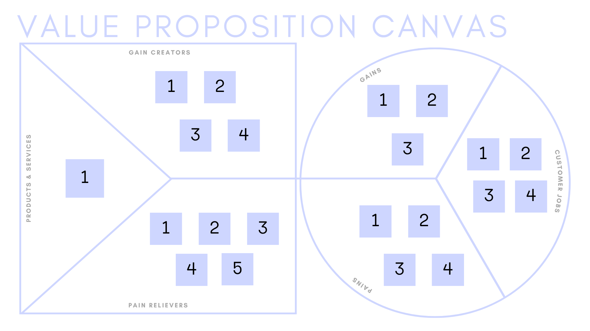<br>
<sup>Fonte: Material produzido pelos autores (2025)</sup>
</div>

#### 1. Customer Profile (Perfil do Usuário)

##### Pains (Dores)

1. **Falta de controle eficiente sobre acessos físicos às áreas técnicas**  
A TIC Trens enfrenta dificuldades em gerenciar os acessos de colaboradores e prestadores de serviço em áreas restritas, como salas técnicas e zonas operacionais. Atualmente, o processo depende de registros manuais e verificações descentralizadas, o que aumenta o risco de entradas não autorizadas e dificulta a rastreabilidade de quem acessou cada local. Essa falta de controle pode comprometer tanto a segurança operacional quanto a integridade dos equipamentos e dados sensíveis da empresa.

2. **Dificuldade na verificação da capacitação dos colaboradores em tempo real**  
A ausência de integração entre os sistemas de capacitação e os mecanismos de controle de acesso torna difícil confirmar, no momento da entrada, se o colaborador está devidamente treinado para executar a tarefa programada. Isso expõe a empresa a riscos de segurança e descumprimento de normas regulatórias, além de aumentar a probabilidade de acidentes e falhas técnicas causadas por pessoal não habilitado.

3. **Dificuldade na rastreabilidade e auditoria de acessos**  
A falta de registros digitais integrados impede o acompanhamento detalhado de quem acessou cada área, em qual horário e para qual finalidade. Em auditorias internas ou externas, a ausência dessas informações dificulta a comprovação de conformidade e a identificação de falhas no controle de acesso, gerando vulnerabilidades tanto operacionais quanto legais.

4. **Riscos trabalhistas e de segurança devido a acessos indevidos**  
Sem validações automáticas, existe a possibilidade de que colaboradores entrem em áreas restritas sem autorização adequada e ficam expostos a riscos físicos e colocando a empresa em posição vulnerável em casos de acidentes. Além de comprometer a segurança dos funcionários, esse cenário pode resultar em sanções legais e aumentar os custos com indenizações e seguros.

##### Gains (Ganhos)

1. **Aumento da segurança operacional com controle automatizado de acesso**  
Com a implementação de uma solução IoT integrada, a TIC Trens garante que apenas colaboradores devidamente autorizados e capacitados possam acessar áreas técnicas. O controle automatizado reduz drasticamente o risco de acidentes e falhas humanas, promovendo um ambiente de trabalho mais seguro e em conformidade com as normas internas de segurança do trabalho.

2. **Melhoria na eficiência das operações e redução de conflitos de agenda**  
A integração entre o sistema de controle de acesso e o agendamento de atividades permite melhor planejamento e coordenação entre as equipes. Dessa forma, evitam-se sobreposições de tarefas e atrasos causados por conflitos de agenda, resultando em maior fluidez nas operações e otimização do uso dos espaços técnicos.

3. **Maior rastreabilidade e transparência nas atividades de campo**  
Com o registro automatizado de todos os acessos — incluindo data, hora, local e identificação do colaborador —, a empresa passa a dispor de um histórico completo e confiável para auditorias e análises internas. Essa rastreabilidade melhora a gestão de riscos e fornece dados estratégicos para aprimorar os protocolos de segurança e manutenção.


##### Customer Jobs (Tarefas do Cliente)

1. **Gerenciar acessos físicos a áreas técnicas de forma segura e organizada**  
Os gestores e equipes operacionais da TIC Trens precisam controlar quem entra e sai das áreas técnicas, garantindo que apenas pessoas autorizadas tenham acesso. Atualmente, esse processo é realizado de maneira manual ou fragmentada, exigindo verificação de listas, comunicação entre equipes e conferência física no local, o que consome tempo e está sujeito a erros humanos.

2. **Agendar e coordenar atividades de manutenção e implantação em áreas restritas**  
Os gestores de operação precisam planejar e organizar o uso das áreas técnicas, conciliando diferentes demandas e evitando conflitos de agenda entre equipes. Sem um sistema integrado, essa coordenação depende de planilhas ou comunicações informais, o que pode gerar atrasos, sobreposições e falhas de planejamento.

3. **Manter registros confiáveis para auditorias e conformidade**  
A empresa deve registrar com precisão todos os acessos realizados, incluindo identificação do colaborador, horário, local e motivo do acesso. Essa rastreabilidade é essencial para auditorias internas, inspeções de segurança e certificações de conformidade, mas atualmente é dificultada pela ausência de um sistema centralizado e automatizado.

4. **Responder rapidamente a situações de risco ou acessos indevidos**  
Em casos de tentativas de acesso não autorizado ou irregularidades, os gestores precisam ser notificados em tempo real para agir imediatamente. A falta de um sistema que gere alertas automáticos e permita o monitoramento contínuo reduz a capacidade de resposta, aumentando os riscos à segurança e à operação.

#### 2. Value Map (Mapa de Valor)

##### Pain Relievers (Aliviadores de Dores)

1. **Automatização do controle de acesso físico com validação de credenciais**  
A solução IoT elimina a necessidade de verificações manuais, automatizando o processo de entrada em áreas técnicas por meio de sensores, leitores RFID ou autenticação biométrica. O sistema valida, em tempo real, se o colaborador está autorizado e capacitado para acessar o local, reduzindo significativamente o risco de entradas indevidas e erros humanos.

2. **Integração com banco de dados de capacitação e agendamento de atividades**  
O sistema é projetado para se conectar aos registros internos de capacitação e ao cronograma de atividades da TIC Trens. Essa integração permite verificar automaticamente se o colaborador possui as certificações exigidas para a tarefa agendada, além de cruzar informações com o calendário de manutenções e implantações, evitando sobreposições e conflitos de agenda.

3. **Emissão de alertas automáticos para acessos não autorizados ou riscos operacionais**  
O sistema envia notificações em tempo real quando detecta tentativas de acesso indevido, capacitação vencida ou incompatibilidade entre a atividade programada e o colaborador. Esses alertas permitem uma resposta imediata da equipe de segurança ou do gestor responsável, prevenindo incidentes e reforçando o controle sobre áreas críticas.

4. **Registro digital centralizado e rastreável de todos os acessos**  
Todos os eventos de entrada e saída são registrados em um banco de dados seguro e auditável, incluindo identificação do colaborador, data, hora e motivo do acesso. Essa rastreabilidade facilita auditorias, inspeções de conformidade e investigações internas, oferecendo total transparência e confiabilidade às operações.

5. **Redução da burocracia e do tempo gasto em processos de verificação**  
Ao automatizar a checagem de permissões e capacitações, o sistema reduz o tempo gasto com tarefas administrativas e libera as equipes para focarem em atividades estratégicas. Além disso, a eliminação de registros em papel e controles paralelos diminui o retrabalho e aumenta a eficiência operacional.

##### Products & Services (Produtos e Serviços)

1. **Aplicação de IoT para o controle inteligente de acesso físico a áreas técnicas**  
A solução proposta para a TIC Trens utiliza a tecnologia IoT para automatizar o controle de acesso em ambientes restritos, integrando dispositivos físicos e sistemas digitais em uma única plataforma. Sensores, leitores RFID e autenticação biométrica são utilizados para registrar entradas e saídas em tempo real, garantindo que apenas colaboradores devidamente autorizados e capacitados possam acessar áreas técnicas. A aplicação se conecta diretamente ao banco de dados de capacitação e ao sistema de agendamento de atividades, permitindo a validação instantânea das permissões conforme as exigências de cada tarefa. Além disso, o sistema envia alertas para tentativas de acesso indevido e disponibiliza um painel simples para verificação de eventos registrados. Essa integração entre hardware e software oferece um controle preciso, seguro e eficiente, reduzindo riscos operacionais, melhorando a rastreabilidade e fortalecendo a gestão de segurança da empresa.

##### Gain Creators (Criadores de Ganho)

1. **Aprimoramento da segurança e conformidade nas operações**  
A solução IoT garante que apenas colaboradores devidamente qualificados e autorizados tenham acesso às áreas técnicas, reduzindo drasticamente a ocorrência de incidentes e falhas operacionais. Isso reforça a conformidade com normas de segurança e políticas internas, além de proporcionar maior controle e segurança às equipes de gestão e auditoria.

2. **Otimização do planejamento e coordenação das atividades técnicas**  
Com a integração de dados de agendamento, capacitação e acesso em um único sistema, a TIC Trens pode planejar as atividades de manutenção e implantação de maneira mais eficiente. Isso evita sobreposições de tarefas, reduz o tempo ocioso e melhora a produtividade das equipes de campo.

3. **Redução de custos operacionais e administrativos**  
A automatização dos processos de controle de acesso e verificação de capacitação reduz a necessidade de trabalho manual e a dependência de múltiplos sistemas. Isso gera economia de tempo e recursos, permitindo que as equipes se concentrem em tarefas de maior valor agregado.

4. **Tomada de decisão mais ágil e baseada em dados**  
Com relatórios em tempo real e indicadores de acesso, a empresa tem maior capacidade de ação em situações importantes, consegue antecipar riscos e tomar decisões mais embasadas. A visibilidade contínua sobre o fluxo de pessoas e atividades nas áreas técnicas aumenta o controle operacional e contribui para uma gestão mais estratégica e inteligente.

#### Conclusão

&nbsp;&nbsp;&nbsp;&nbsp;Em conclusão, a aplicação do Value Proposition Canvas ao contexto da TIC Trens evidencia a importância de alinhar a proposta de valor da solução IoT às reais necessidades operacionais e de segurança da empresa. A análise das dores e desafios enfrentados — como a falta de controle eficiente de acessos, os riscos trabalhistas e a dificuldade de rastreabilidade — permite compreender de forma clara os pontos críticos que comprometem a eficiência e a conformidade da organização. Com isso, a TIC Trens obtém ganhos tangíveis, como o aumento da segurança operacional, a redução de custos administrativos e a melhora significativa da conformidade regulatória. A integração entre controle de acesso, gestão de capacitação e rastreabilidade de operações reafirma a TIC Trens como exemplo de segurança industrial e demonstra como o uso estratégico de IoT pode transformar processos críticos em sistemas inteligentes, seguros e eficientes.

### 3.1.5. Matriz de Riscos (sprint 1)	

A matriz de riscos é uma ferramenta utilizada para identificar, qualificar e categorizar os riscos que podem ocorrer ao longo do projeto, classificando-os em Ameaças (riscos negativos) e Oportunidades (riscos positivos).

Os riscos identificados são posicionados na matriz conforme sua qualificação nos dois eixos principais:

- Eixo X (Impacto): varia entre Muito Baixo, Baixo, Médio, Alto e Muito Alto;

- Eixo Y (Probabilidade): representado pelos valores 10%, 30%, 50%, 70% e 90%.

A matriz é estruturada de forma espelhada, permitindo a visualização e comparação entre ameaças e oportunidades de maneira equilibrada e intuitiva.

<div align="center">
<sub>Imagem 04: Matriz de Risco</sub>
</div>
<div align="center">
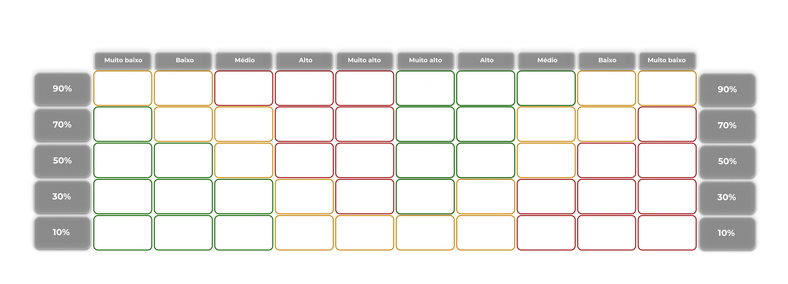
</div>
<div align="center">
<sub>Fonte: Material produzido pelo Time DedSec, 2025.</sub>
</div> 

#### 3.1.5.1. Ameaças 

&nbsp;&nbsp;&nbsp;&nbsp; As ameaças representam os riscos negativos identificados, ou seja, aqueles que podem causar impactos adversos ou dificultar o andamento e a execução do projeto. Identificar essas ameaças antecipadamente é uma forma de proteger o projeto e garantir que ele siga o cronograma, orçamento e qualidade planejados.

- **1 - Risco de invasão por falha na segurança:**

    **Impacto:** Muito Alto.<br>
    **Probabilidade:** 10%.

    &nbsp;&nbsp;&nbsp;&nbsp; A invasão de terceiros aos ambientes de autênticação e proteção da solução por cópia do RFID ou até mesmo invasões no sistmea de segurança representa um risco muito alto para a solução, já que afeta completamente a credibilidade da equipe e confiança da parceira no projeto.
    <br>

- **2 - Dificuldade no planejamento para implementação por falta de estrutura:**

    **Impacto:** Médio.<br>
    **Probabilidade:** 10%.

    &nbsp;&nbsp;&nbsp;&nbsp; A empresa parceira necessita de segurança nas salas das estações e nos canteiros de obras que ainda não possuem um planejamento adequado ou uma planta definida para orientar a instalação e o mapeamento do local. Por esse motivo, a equipe pode enfrentar dificuldades durante o processo de planejamento e adaptação da solução às necessidades da empresa, devido à falta de estrutura prévia.
    <br>

- **3 - Custo de manutenção:**

    **Impacto:** Baixo.<br>
    **Probabilidade:** 10%.
    
   &nbsp;&nbsp;&nbsp;&nbsp;  Devido a grande quantidade de salas e múltiplas implementações em diferentes lugares, podem haver danos aos equipamentos, o que representa um risco por um alto custo de manutenção.
   <br>

- **4 - Perda de energia elétrica durante a operação:**


    **Impacto:** Muito Alto.<br>
    **Probabilidade:** 50%.

    &nbsp;&nbsp;&nbsp;&nbsp; A possível falta de energia elétrica durante as operações da empresa parceira pode comprometer o funcionamento contínuo da solução, afetando diretamente sua confiabilidade. Além disso, fatores ambientais e geográficos, como chuvas intensas, variações bruscas de temperatura e exposição prolongada a condições climáticas adversas, podem danificar os equipamentos, causar falhas operacionais e comprometer a segurança do sistema. Esses fatores representam um risco elevado à disponibilidade e à credibilidade da solução proposta.

    <br>

- **5 - Erro humano na permissão de acesso:**

    **Impacto:** Médio.<br>
    **Probabilidade:** 50%.


    &nbsp;&nbsp;&nbsp;&nbsp; Um ponto negativo para a solução está relacionado à possibilidade de erro humano durante o processo de concessão ou controle de acesso. Falhas como o cadastro incorreto de usuários, esquecimento de credenciais ou permissões atribuídas de forma indevida podem comprometer a segurança do sistema e permitir acessos não autorizados. Esse risco reforça a importância de implementar camadas adicionais de autenticação, registros de auditoria e treinamentos adequados aos responsáveis pela gestão dos acessos.
    <br>

&nbsp;&nbsp;&nbsp;&nbsp; As ameaças identificadas permitem prever possíveis riscos que podem influenciar negativamente o andamento da solução, possibilitando que a equipe adote medidas preventivas e estratégias de mitigação para reduzir seus impactos durante o desenvolvimento e a implementação do projeto.
<br>

#### 3.1.5.2. Oportunidades 

&nbsp;&nbsp;&nbsp;&nbsp; As oportunidades são situações ou condições favoráveis que, se aproveitadas, podem gerar benefícios ou vantagens para o projeto.
Elas funcionam como o “lado positivo” da análise de riscos: enquanto os riscos representam ameaças, as oportunidades representam possibilidades de ganho.

- **6 - Utilização de criptografia:** como diferencial competitivo

    **Impacto:** Muito Alto.<br>
    **Probabilidade:** 50%.

     &nbsp;&nbsp;&nbsp;&nbsp; A adoção de técnicas avançadas de criptografia como parte da solução IoT representa uma oportunidade de destaque no mercado, agregando valor e aumentando a confiança dos clientes em relação à segurança de dados e acessos.
     A utilização de uma criptografia pós-quântica permitiria elevar exponencialmente o nível de segurança da solução. Essa abordagem diferencia o produto frente a concorrentes e fortalece a imagem da empresa parceira como inovadora e comprometida com a proteção das informações sensíveis.
    <br>

- **7 - Implementação real da solução:**

    **Impacto:** Muito Alto.<br>
    **Probabilidade:** 10%.

    &nbsp;&nbsp;&nbsp;&nbsp; A aplicação prática da solução nas instalações reais da parceira TIC Trens oferece uma oportunidade de validação do projeto, permitindo testes em ambiente operacional e coleta de dados reais sobre desempenho, usabilidade e eficiência. Essa implementação pode gerar visibilidade institucional, ampliar o portfólio de soluções tecnológicas e abrir novas possibilidades de expansão para outras unidades ou empresas do mesmo setor.
    <br>

- **8 - Implementação de autenticação multifator:**


    **Impacto:** Alto.<br>
    **Probabilidade:** 70%.

    &nbsp;&nbsp;&nbsp;&nbsp; A inclusão de autenticação multifator combinando RFID, senha e outros métodos de autênticação via aplicativo fortalece significativamente a segurança do sistema, reduzindo as chances de acesso não autorizado. Além de proteger informações sensíveis, essa funcionalidade amplia o valor da solução e a adequa a padrões modernos de segurança digital, tornando-a mais atrativa para futuras aplicações corporativas.
    <br>

- **9 - Alteração da senha com o decorrer do tempo para evitar clonagem/fraude do RFID:**

    **Impacto:** Médio.<br>
    **Probabilidade:** 70%.

    &nbsp;&nbsp;&nbsp;&nbsp; A implementação de um sistema de atualização periódica de senhas associadas ao RFID contribui para a redução de vulnerabilidades e fraudes. Essa prática reforça a confiabilidade da solução, permitindo que o sistema se adapte continuamente a potenciais ameaças e mantenha a integridade do controle de acesso ao longo do tempo.
    <br>

- **10 - Criação de uma patente ou artigo científico do projeto:**

    **Impacto:** Alto.<br>
    **Probabilidade:** 30%.

    &nbsp;&nbsp;&nbsp;&nbsp; O desenvolvimento bem-sucedido da solução pode gerar oportunidades acadêmicas e comerciais, como a publicação de artigos científicos ou o registro de uma patente. Isso contribuiria para a visibilidade do grupo e da solução.
    <br>

&nbsp;&nbsp;&nbsp;&nbsp; As oportunidades identificadas permitem elevar o nível de qualidade e eficiência da solução, além de evidenciar cenários favoráveis que podem ser explorados estrategicamente. Com isso, a equipe consegue definir prioridades para o planejamento, desenvolvimento e execução do projeto, maximizando seus resultados e valor agregado.
<br>

#### 3.1.5.3. Conclusão

&nbsp;&nbsp;&nbsp;&nbsp; As ameaças levantadas possibilitam prever e identificar riscos que podem influenciar negativamente o andamento do projeto, como falhas de segurança, interrupções por falta de energia e erros humanos no processo de autenticação. Essa antecipação favorece a elaboração de planos de contingência e a definição de práticas preventivas para garantir maior estabilidade e confiabilidade do sistema IoT desenvolvido.

&nbsp;&nbsp;&nbsp;&nbsp; Por outro lado, as oportunidades destacadas representam caminhos de crescimento e inovação para o projeto, como a implementação de autenticação multifator, a aplicação de criptografia avançada e a possibilidade de criação de uma patente ou publicação científica. Esses fatores contribuem para aumentar a credibilidade, o valor tecnológico e o impacto social da solução proposta.

&nbsp;&nbsp;&nbsp;&nbsp; Dessa forma, a análise da matriz de riscos e oportunidades não apenas orienta as decisões da equipe durante o desenvolvimento, mas também fortalece a segurança e eficiência do projeto em parceria com a TIC Trens.

&nbsp;&nbsp;&nbsp;&nbsp; Segue o link para o design da Matriz de Risco: https://www.figma.com/design/lKAsWLCpfKZVKuKm9DAwO1/Untitled?node-id=0-1&t=mX89bk1b4YsXKFtA-1 

### 3.1.6. Política de Privacidade de acordo com a LGPD  

&nbsp;&nbsp;&nbsp;&nbsp;A Política de Privacidade é um documento essencial no contexto de colaboração entre o grupo DedSec — o Grupo 04 do 4º módulo de 2025 da Turma 18 do Inteli — e a Tic Trens, considerando a necessidade de coleta e análise de dados. Este documento assegura aos usuários, colaboradores e parceiros, enquanto titulares dos dados, que as informações pessoais são tratadas com respeito, responsabilidade e em conformidade com a Lei nº 13.709/2018 — Lei Geral de Proteção de Dados Pessoais (LGPD). (Arquia, 2025)<sup>[1](#foot1)</sup>  

#### 3.1.6.1 Informações gerais sobre a empresa / organização  

&nbsp;&nbsp;&nbsp;&nbsp;O Instituto de Tecnologia e Liderança (Inteli), pessoa jurídica de direito privado, está localizado na Av. Prof. Almeida Prado, 520 - Butantã, São Paulo - SP, 05508-070, e inscrito no CNPJ/MF sob o nº 28.226.170/0001-08.  
&nbsp;&nbsp;&nbsp;&nbsp;Em parceria com a Tic Trens, o Inteli reforça seu compromisso com a proteção de dados pessoais. A colaboração com o time DedSec no projeto de gerenciamento de acessos utiliza plataformas e conexões para coletar e tratar dados de forma responsável, garantindo total conformidade com a legislação vigente.  

#### 3.1.6.2 Informações sobre o tratamento de dados  

&nbsp;&nbsp;&nbsp;&nbsp;O tratamento de dados coletados pelo sistema e integrados à Ubidots tem como principal objetivo monitorar e validar acessos físicos a áreas técnicas, garantindo segurança operacional e integridade das informações.  
&nbsp;&nbsp;&nbsp;&nbsp;O tratamento baseia-se nas hipóteses legais de **execução de contrato** e **legítimo interesse** (art. 7º, incisos V e IX da LGPD).  

&nbsp;&nbsp;&nbsp;&nbsp;Os dados são tratados conforme os seguintes princípios:  
- **Finalidade**: os dados têm propósitos legítimos, claros e específicos, como autenticação, registro de acessos e geração de relatórios de conformidade.  
- **Adequação**: o tratamento é compatível com as necessidades e objetivos do projeto.  
- **Necessidade**: apenas os dados estritamente necessários são coletados e transmitidos à Ubidots.  
- **Segurança**: medidas técnicas e administrativas são aplicadas para proteger as informações contra acessos não autorizados.  

#### 3.1.6.3 Quais são os dados coletados  

&nbsp;&nbsp;&nbsp;&nbsp;Os dados coletados englobam informações fornecidas diretamente pelos usuários e dados técnicos obtidos automaticamente por dispositivos IoT. Entre eles, estão:  
- **Dados pessoais identificáveis**: nome, identificação corporativa (RFID) e credenciais de acesso.  
- **Dados técnicos e operacionais**: tipo de dispositivo, sistema operacional, localização aproximada (via IP), registros de logs e _timestamps_ de acesso.  
- **Dados provenientes de dispositivos IoT**: identificadores únicos, leituras de sensores e eventos de autenticação coletados pela Ubidots para análise em tempo real.  

&nbsp;&nbsp;&nbsp;&nbsp; Os **dados sensíveis**, como informações relacionadas à saúde ocupacional ou segurança do trabalho, estes recebem tratamento diferenciado, com camadas adicionais de segurança, controle de acesso e anonimização, conforme o art. 11 da LGPD.  

#### 3.1.6.4 Onde os dados são coletados  

&nbsp;&nbsp;&nbsp;&nbsp;Os dados são coletados por meio da **integração entre os dispositivos IoT e a plataforma Ubidots**, que atua como um ponto central de coleta e visualização.  
&nbsp;&nbsp;&nbsp;&nbsp;A comunicação entre os dispositivos (ex: módulos ESP32 com RFID) e a Ubidots ocorre via protocolos MQTT ou HTTP, com autenticação de token e criptografia, garantindo a integridade e confidencialidade das transmissões.  

#### 3.1.6.5 Para quais finalidades os dados serão utilizados  

&nbsp;&nbsp;&nbsp;&nbsp;Os dados coletados têm as seguintes finalidades:  
1. **Monitoramento e controle de acesso**: validar autenticações e registrar entradas em áreas técnicas.  
2. **Gestão de segurança**: identificar tentativas de acesso indevido e emitir alertas em tempo real.  
3. **Auditoria e conformidade**: gerar relatórios de histórico e rastreabilidade para gestores.  
4. **Visualização analítica**: exibir métricas de uso e dados de sensores por meio dos dashboards da Ubidots.  

#### 3.1.6.6 Onde os dados ficam armazenados  

&nbsp;&nbsp;&nbsp;&nbsp;Os dados são armazenados de forma redundante e segura nos **servidores da Ubidots**, que utilizam infraestrutura em nuvem com alto padrão de disponibilidade e segurança.  
&nbsp;&nbsp;&nbsp;&nbsp;A plataforma aplica **criptografia em repouso e em trânsito**, controle de acesso por token e autenticação multifatorial para usuários administrativos. Além disso, a Ubidots realiza auditorias de segurança periódicas e segue conformidades reconhecidas internacionalmente, como **ISO 27001** e **SOC 2**.  

#### 3.1.6.7 Qual o período de armazenamento dos dados (retenção)  

&nbsp;&nbsp;&nbsp;&nbsp; O período de retenção dos dados (logs de acesso, sessões) será definido em conformidade com as obrigações legais e a política interna de auditoria e segurança da TIC Trens. Para fins de desenvolvimento do projeto acadêmico, os dados serão retidos apenas durante a duração do módulo **(três meses)**, sendo anonimizados ou excluídos após a sua conclusão.

#### 3.1.6.8 Uso de *cookies* e/ou tecnologias semelhantes  

&nbsp;&nbsp;&nbsp;&nbsp;A plataforma web de visualização pode utilizar *cookies* essenciais para manter sessões e preferências de usuário. Esses *cookies* são necessários para o funcionamento adequado da interface e podem ser gerenciados ou desativados pelo navegador do usuário.  

#### 3.1.6.9 Com quem esses dados são compartilhados  

&nbsp;&nbsp;&nbsp;&nbsp;Os dados são compartilhados com a **Tic Trens**, o **Inteli** e a **Ubidots**, responsável pela hospedagem e visualização dos dados IoT. Todos os parceiros seguem políticas internas de segurança e privacidade alinhadas à LGPD.  

#### 3.1.6.10 Informações sobre medidas de segurança adotadas  

&nbsp;&nbsp;&nbsp;&nbsp;O sistema implementa medidas de segurança abrangentes, incluindo:  
- Criptografia ponta a ponta nas comunicações entre dispositivos e servidor.  
- Controle de acesso baseado em papéis (RBAC) e autenticação multifatorial.  
- Segregação de ambientes de desenvolvimento, teste e produção.  
- Anonimização e pseudonimização de dados sensíveis.  
- Logs de auditoria contínuos na Ubidots e no backend do projeto.  

#### 3.1.6.11 Direitos dos titulares de dados  

&nbsp;&nbsp;&nbsp;&nbsp;Os titulares de dados podem exercer seus direitos previstos nos artigos 18 e 19 da LGPD, incluindo:  
1. Solicitar a exclusão ou anonimização de seus dados pessoais.  
2. Corrigir informações incorretas ou desatualizadas.  
3. Solicitar uma cópia de todos os dados tratados.  

&nbsp;&nbsp;&nbsp;&nbsp;As solicitações devem ser enviadas para [parcerias@inteli.edu.br](mailto:parcerias@inteli.edu.br) e serão atendidas em até **15 dias**, conforme a legislação vigente.  

#### 3.1.6.12 Contato do Encarregado de Proteção de Dados (DPO)  

&nbsp;&nbsp;&nbsp;&nbsp;O Encarregado de Proteção de Dados (DPO) é responsável por supervisionar as práticas relacionadas ao tratamento de dados pessoais no projeto. O contato pode ser realizado pelo e-mail [dpo@inteli.edu.br](mailto:dpo@inteli.edu.br), informando o motivo da solicitação e os dados necessários para identificação.  

&nbsp;&nbsp;&nbsp;&nbsp;O grupo DedSec reafirma seu compromisso com a **transparência**, **segurança da informação** e **conformidade legal**, garantindo que todas as práticas de tratamento de dados — tanto na infraestrutura interna quanto na Ubidots — estejam alinhadas à LGPD e às diretrizes éticas do Inteli.


### 3.1.7. Bill of Material (BOM)

A Bill of Materials é uma lista que contempla todos os itens utilizados para construção do protótipo IoT. Esse processo de registros de mateirais utilizados é importante pois garante rastreabilidade, padronização e facilita tanto a montagem quanto futuras manutenções ou reproduções da solução.

<div align="center">
<sub>Imagem 05: Bill of Materials</sub>
</div>
<div align="center">
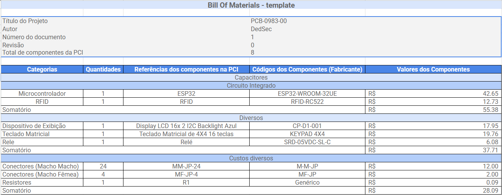
</div>
<div align="center">
<sub>Fonte: Material produzido pelo Time DedSec, 2025.</sub>
</div> 

ESP32 (ESP32-WROOM-32UE): Microcontrolador Wi-Fi e Bluetooth de alto desempenho.

RFID (RFID-RC522): Módulo de leitura por radiofrequência utilizado para identificação de tags RFID em sistemas de controle de acesso ou rastreamento.

Display LCD 16x2 I2C Backlight Azul (CP-D1-001): Visor com interface I2C que exibe até 32 caracteres, facilitando a comunicação visual com o usuário.

Teclado Matricial 4x4 16 teclas (KEYPAD 4X4): Dispositivo de entrada que permite o envio de comandos através de 16 botões dispostos em matriz.

Relé (SRD-05VDC-SL-C): Componente eletromecânico que atua como interruptor controlado eletricamente, permitindo acionar cargas de maior potência.

Conectores Macho-Macho (MM-JP-24): Jumpers usados para conexões diretas entre pinos ou módulos em protoboard ou placas de ensaio.

Conectores Macho-Fêmea (MF-JP-4): Cabos de conexão versáteis usados para interligar módulos e sensores em prototipagem eletrônica.

Resistor 100 Ω (Genérico): Componente passivo que limita a corrente elétrica em um circuito, protegendo componentes sensíveis e garantindo o funcionamento estável.

Portanto, com o BOM é possível ter uma melhor visualização dos componentes utilizados, além de garantir a rastreabilidade e a padronização dos itens. A BOM assegura que cada componente seja corretamente identificado e especificado, contribuindo para a confiabilidade e a eficiência do desenvolvimento do projeto IoT. 

## 3.2. Domínio de Fundamentos de Experiência de Usuário 

### 3.2.1. Personas

A etapa de criação de personas é essencial para o alinhamento do projeto. Com as personas conseguimos identificar as dores que o projeto solucionará, as funções que deve contemplar e o impacto causado na vida do público-alvo, de forma a guiar o projeto numa direção organizada e alinhada. Isto posto, foi determinado que o projeto possuirá duas principais personas: um técnico de manutenção que irá interagir diretamente com a solução IoT desenvolvida e uma gestora de acesso, que terá seu trabalho facilitado pelo sistema. 

Carlos Mendes, 42 anos, é Técnico de Manutenção Eletromecânica com mais de 15 anos de experiência no setor ferroviário. Trabalha diariamente em houses, subestações e salas técnicas, onde realiza inspeções e manutenções em equipamentos elétricos e mecânicos. Para executar suas atividades, precisa acessar diferentes áreas restritas, o que hoje exige solicitações manuais e autorizações demoradas.
Sua principal necessidade é contar com um sistema de acesso ágil e seguro, que reduza a burocracia e elimine esperas desnecessárias antes de iniciar o trabalho em campo.

<div align="center">
<sub>Persona 1 - Técnico de manutenção</sub>
</div>
<div align="center">
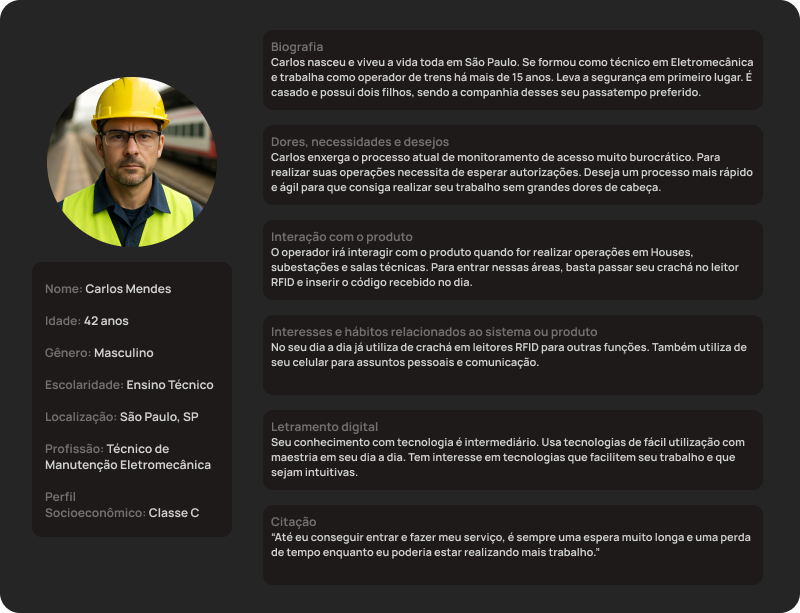
</div>

Beatriz Nunes, 29 anos, é Analista de Gestão de Terceiros – Gestão de Acesso, com formação em Logística e mais de 5 anos de experiência no setor ferroviário. É responsável por monitorar a circulação de equipes e controlar acessos às áreas operacionais, garantindo a segurança das vias e a conformidade dos processos.
Sua principal necessidade é dispor de um sistema centralizado e confiável de monitoramento de acessos, que permita acompanhar em tempo real quem entrou, onde e quando. Além disso, deseja receber alertas automaticamente sobre tentativas de entrada não autorizadas.

<div align="center">
<sub>Persona 2 -  Gestora de acessos</sub>
</div>
<div align="center">
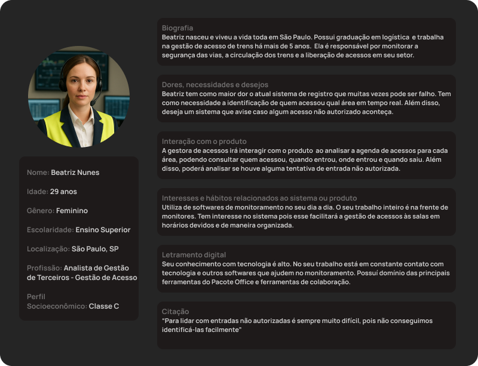
</div>

Para melhor visualização, acesse nosso [figma](https://www.figma.com/design/kGDeEGhxhv6GqoSpoG70At/Tic-Trens?node-id=0-1&t=Zh99GbnlH5k2zP99-1).

Portanto a criação de personas se mostra uma etapa imprescindível para o direcionamento e contiunuidade do projeto, de forma a ser um guia para conseguirmos chegar no resultado masi satisfatório para a Tic Trens.

### 3.2.2. Jornada do Usuário e Storyboard	

&nbsp;&nbsp;&nbsp;&nbsp;A jornada do usuário é uma representação visual e narrativa da experiência de uma pessoa ao interagir com um produto, serviço ou sistema. Ela descreve, passo a passo, o caminho percorrido pelo usuário, desde o primeiro contato até o alcance de seus objetivos, destacando ações, emoções, desafios e oportunidades da persona.

&nbsp;&nbsp;&nbsp;&nbsp; Mais do que um simples fluxo de tarefas, a jornada busca compreender o contexto humano por trás das interações, revelando o que o usuário pensa, sente e precisa em cada momento. 
 
#### 3.2.2.1 Jornada de Usuário: Carlos Mendes

&nbsp;&nbsp;&nbsp;&nbsp;Carlos Mendes é operador de manutenção em subestações, salas técnicas e áreas restritas das obras realizadas pela Tic Trens. No seu dia a dia, ele precisa acessar constantemente ambientes de acesso controlado. Atualmente, o processo de autorização é lento e burocrático.


&nbsp;&nbsp;&nbsp;&nbsp; Ele espera que o novo sistema, em fase de implementação pela empresa, automatize sua rotina de trabalho, tornando o acesso mais ágil, confiável e seguro — sem a necessidade de múltiplas autorizações humanas.

#### 3.2.2.1.1 Fases

&nbsp;&nbsp;&nbsp;&nbsp; As fases da jornada do usuário representam os processos pelos quais ele passará durante a utilização do sistema, bem como todas as interações envolvidas nesse percurso.

**Fase 1:** Solicitação

&nbsp;&nbsp;&nbsp;&nbsp; Ao chegar à base de operações, Carlos precisa solicitar autorização para acessar uma sala técnica e iniciar suas atividades. Após a solicitação, ele recebe um cartão RFID com o UID cadastrado e se dirige a área de manutenção.

- **Pensamento:** "Tomara que hoje o processo não demore"

- **Sentimento:** Carlos se sente **frustrado** por demorar tanto tempo para iniciar sua jornada do trabalho, mas entende que é uma etapa necessária para garantir a segurança da operação.

<br>

**Fase 2:** Autenticação

&nbsp;&nbsp;&nbsp;&nbsp; Ao chegar à área restrita, Carlos aproxima seu cartão RFID do sensor e prossegue para a etapa de verificação por senha. O sistema envia automaticamente um código de até seis dígitos via SMS para o número de celular vinculado ao seu UID. 

- **Pensamento:** "Beleza, só inserir o código e posso iniciar o trabalho."

- **Sentimento:** Carlos se sente **aliviado** pois finalmente consegue iniciar sua jornada de trabalho sem complicações.

<br>

**Fase 3:** Entrada

&nbsp;&nbsp;&nbsp;&nbsp; Após a validação das credenciais, o sistema libera automaticamente a porta. Carlos entra na sala restrita e realiza as manutenções necessárias para garantir o funcionamento adequado dos sistemas.
&nbsp;&nbsp;&nbsp;&nbsp; Ao entrar na sala técnica, o sistema armazena que na área delimitada que Carlos entrou, estão havendo manutenções e exibe essa área para o Gestor de Acessos, evitando contratempos e garantindo que não haja circulação de trens ou passagens de pessoas durante esse processo.

- **Pensamento:** "Agora sim, consigo fazer meu serviço sem precisar ficar esperando liberação e com garantia."

- **Sentimento:** Carlos se sente **satisfeito** pois finalmente consegue realizar seu trabalho com segurança.

<br>

**Fase 4:** Manutenção

&nbsp;&nbsp;&nbsp;&nbsp; Enquanto permanece na sala técnica, Carlos é monitorado pelo sistema IoT, que registra presença, tempo de permanência e condições do ambiente para garantir a conformidade com os protocolos de segurança.
&nbsp;&nbsp;&nbsp;&nbsp; Ao entrar na sala técnica, o sistema IoT registra automaticamente no banco de dados o início da jornada de trabalho de Carlos. Essa automação garante um controle preciso de presença e tempo de permanência, além de reforçar a segurança operacional. Em caso de qualquer irregularidade durante as atividades, o registro digital permite identificar com clareza quem estava no local, assegurando transparência e responsabilidade em todo o processo.

- **Pensamento:** "Bom saber que o sistema registrou tudo."

- **Sentimento:** Carlos se sente **Neutro**.

<br>

**Fase 5:** Garantia

&nbsp;&nbsp;&nbsp;&nbsp; Ao encerrar sua jornada, Carlos tem a tranquilidade de saber que todo o seu ciclo de acesso foi devidamente registrado e validado pelo sistema IoT. Cada entrada e saída é automaticamente comparada com os horários autorizados, eliminando falhas manuais e garantindo precisão nos registros. Essa automatização reforça a segurança operacional e assegura que, em caso de incidentes, as responsabilidades sejam atribuídas de forma justa e transparente.

- **Pensamento:** "O sistema funcionou bem hoje, tudo rápido e sem falhas."

- **Sentimento:** Carlos se sente **Confiante**, pois possui garantia na execução do seu trabalho.

<br>

**Oportunidades:**

- Evitar que problemas de segurança caiam sobre sua responsabilidade, já que o sistema automatiza automaticamente a segurança de entrada e saída das áreas restritas.
- O sistema pode registrar automaticamente hora de entrada e saída.
- Implementar relatórios automáticos de entrada/saída, facilitando o trabalho do operador ao final do expediente.

<br>

**Responsabilidades:**

- Cumprir os protocolos de autenticação e segurança.
- Reportar falhas ou inconsistências ao sistema, para evitar erros de segurança.
- Realizar manutenções dentro das áreas liberadas pelo sistema no horário permitido.
 

<div align="center">
<sub>Jornada 1 -  Operador de Manutenção</sub>
</div>
<div align="center">
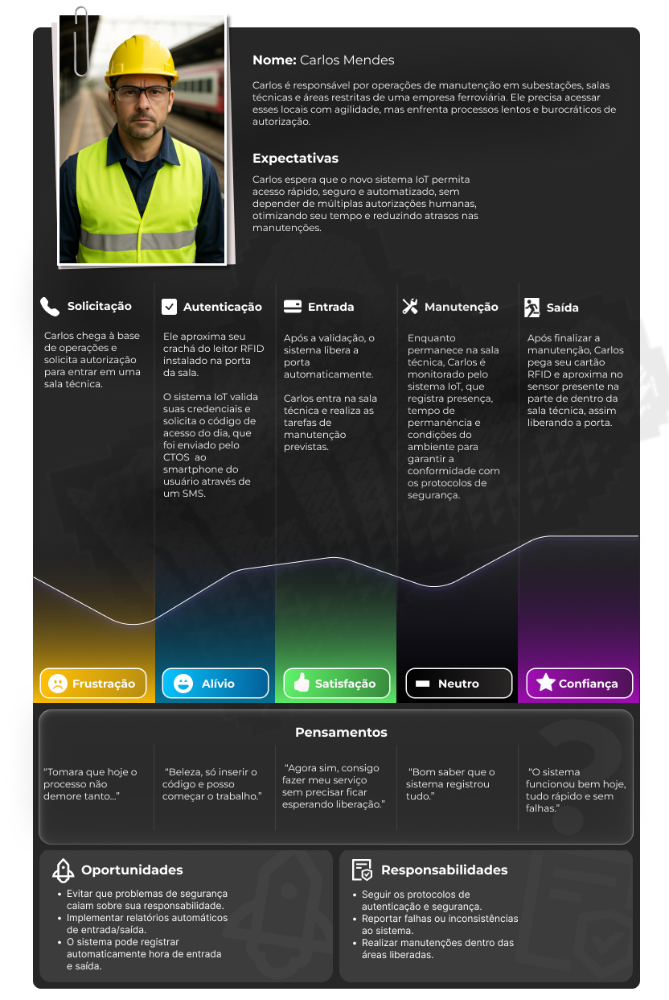
</div>
<div align="center">
<sub>Fonte: Autoria da equipe Dedsec.</sub>
</div>
<br>

&nbsp;&nbsp;&nbsp;&nbsp; A jornada do usuário Carlos Mendes permite identificar claramente as etapas e necessidades de um dos perfis finais da solução: o operador que precisa se autenticar para realizar manutenções.

&nbsp;&nbsp;&nbsp;&nbsp; Carlos espera que o novo sistema proporcione acesso rápido e seguro às salas técnicas, eliminando processos de autenticação demorados e a dependência de múltiplas autorizações. Isso otimiza seu tempo e evita atrasos em manutenções que, muitas vezes, são urgentes.

&nbsp;&nbsp;&nbsp;&nbsp; Com o novo sistema, sua rotina é facilitada: ele não precisa mais gerar relatórios manuais, sua presença é registrada automaticamente e sua responsabilidade por falhas de segurança é mitigada.

#### 3.2.2.2 Jornada de Usuário: Beatriz Nunes

&nbsp;&nbsp;&nbsp;&nbsp; Beatriz Nunes é analista de gestão de terceiros na Tic Trens, formada em Logística e com mais de cinco anos de experiência no setor ferroviário. É a principal responsável por monitorar a circulação das equipes e controlar os acessos às áreas operacionais, garantindo a segurança das vias, das áreas restritas e a conformidade dos processos.
Ela espera que o novo sistema automatize tarefas anteriormente realizadas de forma manual e evite falhas de segurança que possam recair sobre sua responsabilidade.

#### 3.2.2.2.1 Fases

&nbsp;&nbsp;&nbsp;&nbsp; As fases da jornada do usuário representam os processos pelos quais ele passará durante a utilização do sistema, bem como todas as interações envolvidas nesse percurso.

**Fase 1:** Entrada

&nbsp;&nbsp;&nbsp;&nbsp; Nesta etapa, Beatriz realiza o login no painel do sistema e visualiza todos os acessos requisitados às áreas restritas, além de ter acesso aos UIDs dos operadores cadastrados.
&nbsp;&nbsp;&nbsp;&nbsp; Além disso, Bia pode associar e gerar novos UID de funcionários já cadastrados a um novo cartão RFID, caso haja perca do cartão ou novas autorizações. 

- **Pensamento:** "Será que o sistema já atualizou tudo do turno anterior?"

- **Sentimento:** Beatriz se sente concentrada na operação e verificação do sistema.

<br>

**Fase 2:** Monitoramento

&nbsp;&nbsp;&nbsp;&nbsp; Beatriz monitora os acessos por meio dos logs do sistema, que registram com precisão os horários de entrada e saída dos usuários. Além disso, ela visualiza em um mapa todas as manutenções em andamento, seja em salas específicas ou em trechos da linha férrea. Essa visão integrada permite identificar automaticamente as áreas onde não deve haver circulação de trens, garantindo que apenas profissionais autorizados acessem zonas restritas e evitando riscos de acesso indevido por terceiros.

- **Pensamento:** "Será que essa pessoa já tem os treinamentos válidos e permissão necessária?"

- **Sentimento:** Beatriz fica focada na situação, principalmente para não cometer erros na verificação.

<br>


**Fase 3:** Notificação

&nbsp;&nbsp;&nbsp;&nbsp; O sistema envia notificações sempre que alguém acessa uma área restrita. Caso o indivíduo permaneça além do horário autorizado, um alerta é exibido na tela e a cor da área de manutenção muda no mapa, indicando a infração.

- **Pensamento:** “Preciso verificar se alguém está no horário além do horário permitido.”

- **Sentimento:** Ela fica muito atenta e preocupada nessa situação, principalmente porque a mensagem de alerta se trata de um momento crítico durante sua jornada.

<br>

**Fase 4:** Comunicação

&nbsp;&nbsp;&nbsp;&nbsp; Durante o monitoramento, Beatriz atua como elo entre a operação e o setor de segurança. Ela acompanha, em tempo real, o fluxo de pessoas e o cumprimento das normas de acesso, especialmente em zonas que exigem autorização prévia ou tempo máximo de permanência.

Durante esse processo, Beatriz tem um papel fundamental, garantindo a integridade das operações (evitando que pessoas não autorizadas acessem áreas críticas) e preservando a segurança física dos colaboradores;

- **Pensamento:** “Preciso avisar que tem alguém que está mais tempo do que permitido em uma área restrita”

- **Sentimento:** Bia se sente muito preocupada nessas situações, pois ela precisa agir sem hesitação, pois um atraso pode representar grande risco na segurança.

<br>

**Fase 5:** Garantia

&nbsp;&nbsp;&nbsp;&nbsp; Beatriz encerra seu turno com a tranquilidade de saber que o sistema automatiza todo o processo de verificação, garantindo que nenhuma falha de segurança passe despercebida. A rastreabilidade das ações e a validação contínua dos acessos asseguram que todas as operações ocorreram dentro dos parâmetros estabelecidos, reforçando a confiabilidade e a responsabilidade do processo.

- **Pensamento:** "Consegui encerrar meu turno sem contratempos."

- **Sentimento:** Ela se sente muito alíviada, principamente porque o sistema antigo não lhe garantia nenhuma salvaguardas, o que causava preocupação e um estresse contante durante a jornada de trabalho.

<br>

**Oportunidades:**

- Implementar fluxos automáticos de aprovação e alertas em tempo real (como acessos fora do horário).
- Garantir controle total sobre quem acessou cada sala.


<br>

**Responsabilidades:**

- Validar acessos, monitorar movimentações, gerar relatórios, garantir segurança e conformidade.
- Comunicar incidentes, colaborar com equipes de TI e segurança, apoiar treinamentos de uso do sistema.
- Gerar novos cartões para funcionários já cadastrados.

 

<div align="center">
<sub>Jornada 2 - Analista de Gestão de Terceiros</sub>
</div>
<div align="center">
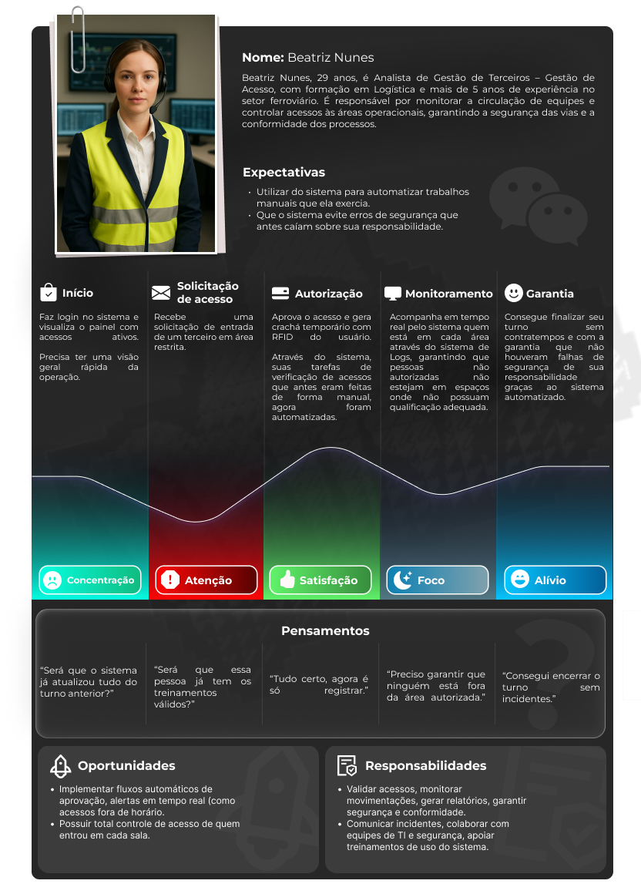
</div>
<div align="center">
<sub>Fonte: Autoria da equipe Dedsec.</sub>
</div>
<br>

A partir da jornada de Beatriz, é possível mapear todas as interações que o gestor de acesso, principal beneficiário do sistema IoT, estabelece com a solução. Beatriz espera que o sistema lhe proporcione não apenas mais confiança e segurança ao longo de sua jornada, mas também que automatize grande parte das tarefas anteriormente realizadas de forma manual, reforçando a segurança nas obras e estações.

Para melhor visualização do Mapa da Jornada de Usuário, segue o link do projeto produzido no Figma pela equipe: https://www.figma.com/design/okP2h2ZcSdpnKuPk64hLno/Untitled?node-id=4-2809&t=hg5T2g4TZcBTWzWn-1

#### 3.2.2.3 Storyboard

Storyboards são representações visuais de como o sistema funciona. Sendo assim, por meio de quadrinhos, representam de forma sequencial as interações entre o usuário e o sistema, ilustrando o fluxo das ações, decisões e respostas esperadas. No contexto do projeto IoT para Tic Trens, o storyboard tem como objetivo demonstrar de maneira clara e intuitiva como a equipe de manutenção e a equipe de gestão de acessos interagem com os dispositivos IoT e com a interface de monitoramento do sistema.

Para isso, foram criadas duas Storyboards, uma demonstrando como a equipe de manutenção interage com o dispositivo IoT desenvolvido pelo grupo, e o segundo demonstrando como o trabalho do CCO é beneficiado com o projeto e com o dashboard

#### 3.2.2.3.1 Storyboard: Carlos Mendes

<div align="center">
<sub>Storyboard 1 - Carlos Mendes</sub>
</div>
<div align="center">
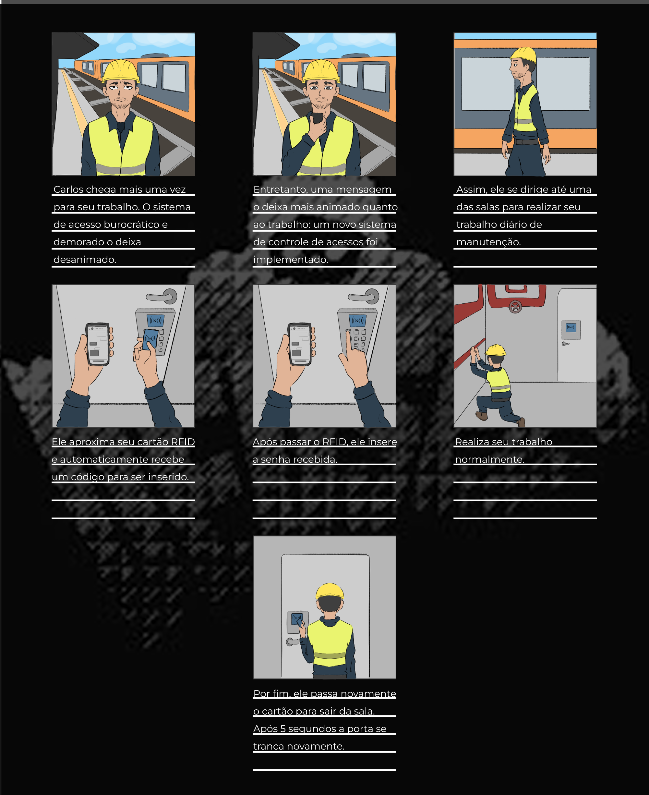
</div>
<div align="center">
<sub>Fonte: Autoria da equipe Dedsec.</sub>
</div>
<br>

Cena 1: Carlos está desanimado por mais um dia ter que lidar com o sistema demorado e burocrático de autorizações de acessos às salas.

Cena 2: Carlos recebe uma mensagem no celular do CCO dizendo que o sistema foi atualizado, se tornando mais prático para realização de seus serviços.

Cena 3: Feliz com a mudança, Carlos se dirige até uma das salas no qual tinha de prestar serviço.

Cena 4: Chegando na sala, ele observa o novo sistema, assim, aproxima seu cartão RFID do sensor e logo em seguida recebe um código de acesso pelo seu celular.

Cena 5: Após passar o cartão e visualizar a mensagem, Carlos digita o código no painel e consegue abrir a porta.

Cena 6: Carlos realiza seu trabalho, sem grandes demoras para conseguir entrar na sala e sem burocracias.

Cena 7: Após terminar seu trabalho, Carlos passa novamente seu cartão para sair da sala, registrando então o horário de saída.

#### 3.2.2.3.2 Storyboard: Beatriz Nunes

<div align="center">
<sub>Storyboard 2 - Beatriz Nunes</sub>
</div>
<div align="center">
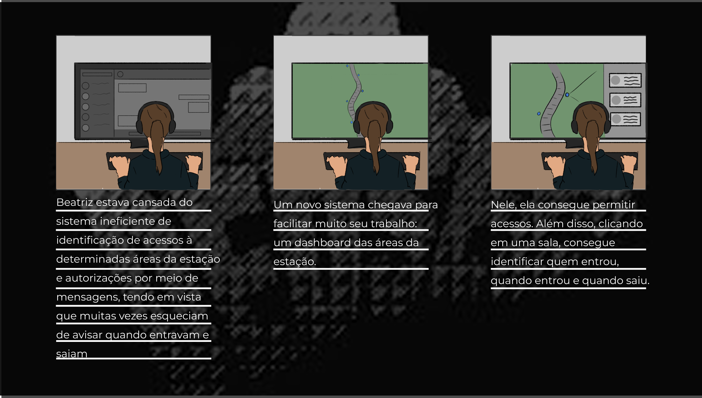
</div>
<div align="center">
<sub>Fonte: Autoria da equipe Dedsec.</sub>
</div>
<br>

Cena 1: Beatriz estava utilizando do sistema antigo, de autorizações e pedidos de autorizações de acesso via mensagens, o que não era eficiente tendo em vista que muitas das vezes os trabalhadores esqueciam de avisar quando saiam e outros erros humanos vinham a acontecer.

Cena 2: Chegou um novo sistema: um dashboard que mostra todas as áreas de acesso no decorrer da estação de metrô.

Cena 3: Clicando em uma das salas, Beatriz consegue analisar quem entrou naquela sala, quando entrou e quando saiu. 

Portanto, fica claro que as storyboards são essenciais para se ter uma melhor visualização de como o sistema funciona e como afeta no dia a dia dos usuários. Eles facilitam o entendimento do fluxo de ações, destacando as melhorias, em relação ao sistema antigo, trazidas pela automação e pelo dashboard de monitoramento.


### 3.3.1. Requisitos Funcionais

&nbsp;&nbsp;&nbsp;&nbsp;Os requisitos funcionais definidos para o sistema de controle de acesso inteligente da TIC Trens foram elaborados com base no fluxo de validação apresentado no diagrama de sequência. Cada requisito busca garantir a segurança das áreas técnicas, a confiabilidade das informações e a rastreabilidade das ações dos colaboradores. O conjunto de requisitos descrito a seguir reflete a integração entre hardware IoT, backend e sistemas corporativos de capacitação e agendamento.  

<div align="center">  
<sub>Quadro 1 - Requisitos Funcionais</sub>

| **ID** | **Requisito** | **Descrição** | **Prioridade** |
|---|---|---|---|
| **RF01** | Coleta de dados via sensor RFID | O dispositivo IoT deve realizar a leitura do identificador único (UID) do crachá RFID do colaborador e coletar os dados de autenticação (RFID + PIN) inseridos via teclado matricial. | Alta |
| **RF02** | Conexão Wi-Fi e comunicação via MQTT | O dispositivo ESP32 deve conectar-se à rede Wi-Fi corporativa e estabelecer comunicação com o broker MQTT para envio e recebimento de mensagens de validação de acesso, utilizando credenciais de autenticação (token/chave única por dispositivo). | Alta |
| **RF03** | Formatação e publicação de dados no protocolo MQTT | O sistema deve formatar os dados coletados (RFID, PIN, timestamp, ID do dispositivo) e publicá-los em tópicos MQTT específicos (ex: `tictrens/acesso/validacao`) para processamento pelo servidor central. | Alta |
| **RF04** | Autenticação multifator e validação de credenciais | O sistema deve validar a autenticação em dois fatores: (1) verificar se o UID do RFID está cadastrado no banco de dados e (2) validar o PIN inserido pelo colaborador. O acesso só será liberado se ambos os fatores forem confirmados. | Alta |
| **RF05** | Verificação de capacitação e agendamento | O backend deve consultar o sistema corporativo de capacitação e agendamento, via API, para verificar se o colaborador possui: (a) certificação válida para a área solicitada e (b) atividade agendada no horário da tentativa de acesso. | Alta |
| **RF06** | Gestão de dispositivos IoT e credenciais | O sistema deve permitir o cadastro, configuração e gerenciamento dos dispositivos IoT na plataforma, incluindo atribuição de identificadores únicos (Device ID), tokens MQTT e vinculação a locais físicos (salas técnicas). | Média |
| **RF07** | Registro e auditoria de eventos de acesso | O sistema deve registrar todos os eventos de acesso (autorizados, negados e falhas de autenticação) em banco de dados, incluindo: ID do colaborador, timestamp, local, resultado da validação e motivo de negação (quando aplicável). | Alta |
| **RF08** | Dashboard corporativo com visualização em tempo real | O sistema deve disponibilizar um dashboard web que exiba em tempo real: (a) eventos de acesso, (b) status dos dispositivos IoT, (c) gráficos de acessos por período/local e (d) alertas visuais e sonoros para tentativas de acesso não autorizadas ou falhas de autenticação. | Alta |
| **RF09** | Criptografia de dados em trânsito | Toda comunicação entre o dispositivo IoT e o broker MQTT, bem como entre o backend e APIs externas, deve utilizar criptografia TLS/SSL para proteger os dados contra interceptação e garantir a integridade das mensagens. | Alta |

<sup>Fonte: Material produzido pelos autores (2025)</sup>
</div>

&nbsp;&nbsp;&nbsp;&nbsp;Essas especificações asseguram que o sistema fornecerá informações precisas e oportunas para os operadores, ao mesmo tempo em que mantém os dados protegidos e a operação dos equipamentos monitorada sob condições seguras para a TIC Trens. A implementação adequada desses requisitos contribuirá para um ambiente de trabalho mais seguro e facilitará a análise de dados e auditorias futuras, além de garantir a continuidade e integridade dos processos de monitoramento e manutenção.

### 3.3.2. Requisitos Não Funcionais  

&nbsp;&nbsp;&nbsp;&nbsp;Os requisitos não funcionais são restrições aplicadas aos requisitos funcionais, ou seja, limitam e qualificam os serviços oferecidos pelo sistema, definindo padrões de qualidade esperados. Para garantir a eficiência e a confiabilidade do sistema de controle de acesso da Tic Trens, o grupo adotou como referência a **norma ISO/IEC 25010**, que define oito características essenciais de qualidade de software:  

- **Adequação Funcional**: Funcionalidades que permitem ao usuário realizar suas tarefas corretamente.  
- **Eficiência de Desempenho**: Capacidade do sistema de oferecer respostas rápidas e uso otimizado de recursos.  
- **Compatibilidade**: Habilidade de integração e interoperabilidade com outros sistemas e componentes.  
- **Usabilidade**: Facilidade de aprendizado e uso do sistema por parte do usuário.  
- **Confiabilidade**: Capacidade de manter o funcionamento adequado mesmo diante de falhas.  
- **Segurança**: Garantia de integridade, confidencialidade e disponibilidade das informações.  
- **Manutenibilidade**: Facilidade de aprimorar, corrigir ou adaptar o sistema conforme necessário.  
- **Portabilidade**: Capacidade de operar em diferentes ambientes e plataformas.  

&nbsp;&nbsp;&nbsp;&nbsp;Com base nesses princípios, foram definidos os seguintes requisitos não funcionais (Quadro 2):  

<div align="center">  
<sub>Quadro 2 - Requisitos Não Funcionais</sub>

| **RNF#** | **Descrição** | **Aspecto de Qualidade** | **Teste** |  
|----------|---------------|--------------------------|------------|  
| **RNF01** | Todas as informações sensíveis dos usuários devem ser armazenadas em banco de dados utilizando algoritmos de criptografia pós-quântica, como Crystals-Kyber para dados em repouso. | Segurança (Criptografia) | Inspecionar o código e a configuração do BD para confirmar o uso do algoritmo Crystals-Kyber. Tentar acessar ou visualizar os dados sensíveis diretamente no BD; eles devem estar ilegíveis. |  
| **RNF02** | O sistema deve seguir fielmente o processo de autenticação em dois fatores (RFID + PIN) e validação via API externa, sem permitir atalhos ou bypass. | Adequação Funcional | Realizar testes de fluxo de autenticação completos, garantindo que o acesso só é concedido após a execução das duas etapas (RFID + PIN) e validação pela API externa. |  
| **RNF03** | Após a validação do usuário e o fechamento completo da porta, o sistema deve acionar o mecanismo de travamento automaticamente dentro de um intervalo máximo de 5 segundos. | Desempenho (Tempo de Resposta) | Usar um cronômetro ou ferramenta de *logging* de sistema para medir o tempo exato entre o evento final do "fechamento completo da porta" e o "acionamento do mecanismo de travamento". Repetir o teste múltiplas vezes (ex: 10 vezes). |  
| **RNF04** | O sistema deve ser compatível com protocolos MQTT e HTTP, permitindo comunicação com a Ubidots e com o backend local. | Compatibilidade | Testar a comunicação do dispositivo IoT com os dois protocolos, verificando se os dados são enviados corretamente tanto para o backend quanto para a plataforma Ubidots. |  
| **RNF05** | O código-fonte do sistema deve ser modularizado e documentado, permitindo que cada componente (IoT, backend e dashboard) possa ser atualizado ou corrigido de forma independente. | Manutenibilidade | Analisar a estrutura de diretórios e documentação do código para verificar a modularização e clareza dos comentários. |  
| **RNF06** | O sistema deve ser capaz de operar tanto em ambiente local (rede da Tic Trens) quanto em ambiente em nuvem, sem necessidade de refatoração de código. | Portabilidade | Implantar e testar o sistema em dois ambientes diferentes (local e remoto), verificando se o funcionamento é idêntico e estável em ambos os casos. |  

<br>  
<sup>Fonte: Material produzido pelos autores (2025)</sup>  
</div>  

&nbsp;&nbsp;&nbsp;&nbsp;A definição desses requisitos assegura que o sistema opere de forma **padronizada, interoperável e em conformidade** com as práticas estabelecidas pela norma ISO/IEC 25010. Assim, garante-se a integridade do processo de autenticação, a confiabilidade na comunicação entre dispositivos e a compatibilidade com diferentes protocolos e plataformas de monitoramento.

### 3.3.3. Arquitetura da Solução (sprint 3)

#### (Diagrama desenvolvido durante a Sprint 1)

<div align="center">
<sub>Diagrama UML da solução</sub>
</div>
<div align="center">
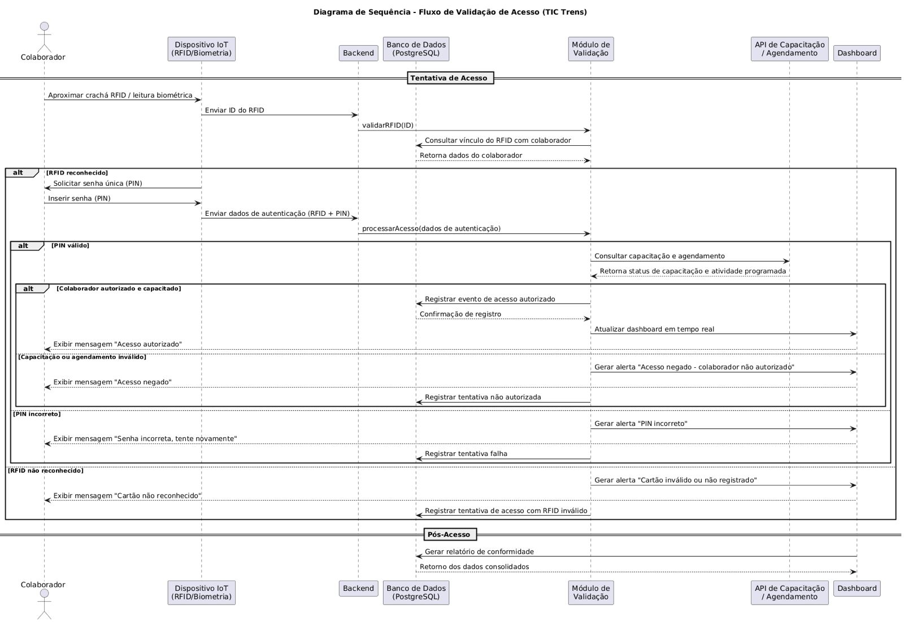
</div>
<div align="center">
<sub>Fonte: Material produzido pelo Time DedSec no PlantUML, 2025.</sub>
</div> 

#### Diagrama de Sequência: Fluxo de Validação de Acesso  

&nbsp;&nbsp;&nbsp;&nbsp;O diagrama de sequência a seguir representa o **fluxo completo de validação de acesso** a uma área técnica da Tic Trens, ilustrando as interações entre os diferentes componentes do sistema: o **Colaborador** (usuário de campo), o **Dispositivo IoT** (hardware instalado na porta), o **Backend** (API principal do sistema), o **Banco de Dados** (armazenamento central), o **Módulo de Validação** (responsável pelas regras de negócio), a **API de Capacitação/Agendamento** (serviço externo fornecido pela Tic Trens) e o **Dashboard** (interface do Centro de Controle Operacional – CCO).  

&nbsp;&nbsp;&nbsp;&nbsp;O processo é composto por **duas fases principais**: a **autenticação de múltiplos fatores (MFA)** e a **validação/autorização de acesso**. Além disso, o sistema inclui rotinas de **resposta**, **notificação em tempo real** e **auditoria pós-acesso**.  

---

##### 1. Autenticação de Múltiplos Fatores (MFA)  

&nbsp;&nbsp;&nbsp;&nbsp;Nesta primeira etapa, o sistema realiza a validação da **identidade do colaborador**, utilizando dois fatores de autenticação distintos para garantir que o usuário que tenta o acesso é realmente quem diz ser.  

1. **Fator 1 – O que o colaborador possui:** o colaborador aproxima o seu **crachá RFID** no **Dispositivo IoT** localizado na entrada da área técnica.  
2. O **Dispositivo IoT** envia o **ID do RFID** ao **Backend**, que encaminha a solicitação ao **Módulo de Validação**.  
3. O **Módulo de Validação** consulta o **Banco de Dados** para verificar se o identificador RFID está cadastrado e vinculado a um colaborador.  
4. **Se o RFID for reconhecido**, o Dispositivo IoT solicita um segundo fator de autenticação — o **PIN (senha única)** — a ser informado pelo colaborador.  
5. O colaborador insere o PIN diretamente no teclado do Dispositivo IoT.  
6. O Dispositivo IoT envia as credenciais completas (**RFID + PIN**) para o Backend, que encaminha os dados para o Módulo de Validação processar a autenticação.  

---

##### 2. Validação e Autorização  

&nbsp;&nbsp;&nbsp;&nbsp;Após a confirmação da identidade do colaborador, o sistema realiza a verificação de **autorização de acesso**, consultando fontes internas e externas para validar se o acesso é permitido naquele momento.  

1. O **Módulo de Validação** confirma a validade do PIN e associa o colaborador autenticado ao seu perfil no banco de dados.  
2. Se o PIN for **válido**, o sistema consulta a **API de Capacitação e Agendamento** (sistema externo da Tic Trens).  
3. A API retorna as informações sobre **capacitação técnica** e **atividade agendada** do colaborador.  
4. O Backend aplica as **regras de negócio**: o acesso só é autorizado se o colaborador estiver **capacitado**, **agendado** e dentro do **horário permitido**.  
5. Caso contrário, o acesso é negado e o evento é classificado como tentativa não autorizada.  

---

##### 3. Respostas do Sistema  

&nbsp;&nbsp;&nbsp;&nbsp;Dependendo do resultado das validações, o sistema executa uma das três rotas de resposta:  

###### A. Caminho de Sucesso – Acesso Autorizado  
- O PIN é válido e a API confirma capacitação e agendamento ativos.  
- O **Backend** envia ao **Dispositivo IoT** o comando de **liberação de acesso** (acionando o relé e o LED verde).  
- O **Módulo de Validação** registra o evento de “Acesso Autorizado” no **Banco de Dados**.  
- O **Dashboard** é atualizado em tempo real via **WebSocket**, exibindo o nome do colaborador, horário e área acessada.  
- Uma mensagem de confirmação é exibida ao colaborador: **“Acesso autorizado”**.  

###### B. Caminho de Falha – Acesso Negado (Autorização)  
- O PIN é válido, mas a API externa indica falha na autorização (sem agendamento, capacitação vencida ou área incorreta).  
- O **Backend** envia comando de **negação de acesso** ao Dispositivo IoT (mantendo a porta trancada e acendendo o LED vermelho).  
- O evento é registrado no Banco de Dados como “Tentativa Não Autorizada”, com o motivo da recusa.  
- O **Dashboard** recebe um alerta visual e sonoro informando a tentativa de acesso negada.  
- O colaborador vê a mensagem: **“Acesso negado – colaborador não autorizado”**.  

###### C. Caminho de Falha – Acesso Negado (Autenticação)  
- O RFID é inválido ou o PIN está incorreto.  
- O **Backend** envia comando de **falha imediata** ao Dispositivo IoT (LED vermelho).  
- O evento é registrado no Banco de Dados como “Falha de Autenticação”, incluindo a causa (ex: “PIN incorreto” ou “RFID não reconhecido”).  
- O **Dashboard** exibe alerta de segurança em tempo real.  
- O colaborador é informado com a mensagem: **“Senha incorreta, tente novamente”** ou **“Cartão não reconhecido”**.  

---

##### 4. Pós-Acesso e Auditoria  

&nbsp;&nbsp;&nbsp;&nbsp;Todos os registros de autenticação e autorização ficam armazenados no Banco de Dados, compondo o histórico de auditoria do sistema.  
&nbsp;&nbsp;&nbsp;&nbsp;Os gestores podem acessar o **Dashboard do CCO** para gerar **relatórios de conformidade** contendo dados como:  
- Identificação do colaborador;  
- Data, hora e local do acesso;  
- Resultado da validação (autorizado, negado, falha de autenticação);  
- Motivo do bloqueio, quando aplicável.  

&nbsp;&nbsp;&nbsp;&nbsp;Essas informações são essenciais para fins de **segurança operacional**, **auditoria interna** e **cumprimento de normas trabalhistas e de segurança do trabalho**.  

---

##### 5. Observações Técnicas  

- O fluxo foi modelado com base no **princípio de autenticação em dois fatores (MFA)**, reforçando a confiabilidade do sistema.  
- A comunicação entre o Dispositivo IoT e o Backend ocorre de forma segura via **protocolo MQTT ou HTTP com TLS**.  
- O Dashboard utiliza **WebSocket** para atualização em tempo real dos eventos.  
- O sistema registra todos os eventos de falha, sucesso e exceção para auditoria futura e análises de segurança.  
- O modelo de dados é centralizado em **PostgreSQL**, garantindo integridade e rastreabilidade das operações.  


### Diagrama de classes UML

Para obter uma melhor visualização das futuras tabelas do nosso banco de dados, elaboramos um diagrama de classes. Esse diagrama é responsável por representar a modelagem da estrutura estática do sistema, auxiliando no planejamento das tabelas, dos dados que estarão nelas e dos métodos que poderão ser utilizados.
Além disso, o diagrama é fundamental para visualizar as relações entre as classes e identificar a visibilidade dos dados, ou seja, se estarão definidos como públicos ou privados.


<div align="center">
<sub>Diagrama de Classes UML da solução</sub>
</div>
<div align="center">

</div>

<br>

### 1. Classes e Detalhes
<div align="center"> 

#### 1.1. Classe: user

| Tipo | Atributo/Método | Visibilidade | Tipo de Dado/Retorno | Observação |
| :--- | :--- | :--- | :--- | :--- |
| **Atributo** | `id` | Privado (`-`) | `int` | Chave primária. |
| **Atributo** | `timestamp` | Privado (`-`) | `data` | Registro de data/hora. |
| **Atributo** | `rfid` | Privado (`-`) | `str` | Código de autenticação por RFID. |
| **Atributo** | `senha` | Privado (`-`) | `int` | Senha do usuário. **(Recomendação: usar `string` para *hash*)** |
| **Método** | `validarSenha` | Público (`+`) | `bool` | Verifica a validade da senha fornecida. |
| **Método** | `autenticarRFID` | Público (`+`) | `bool` | Realiza a autenticação por código RFID. |
| **Método** | `registrarAcesso` | Público (`+`) | `void` | Registra um evento de acesso do usuário. |
| **Método** | `horarioPermitido` | Público (`+`) | `bool` | Checa se o acesso é permitido no horário atual. |

#### 1.2. Classe: tarefa

| Tipo | Atributo/Método | Visibilidade | Tipo de Dado/Retorno | Observação |
| :--- | :--- | :--- | :--- | :--- |
| **Atributo** | `id` | Privado (`-`) | `int` | Chave primária. |
| **Atributo** | `salaId` | Privado (`-`) | `int` | Chave estrangeira para `sala`. |
| **Atributo** | `localizacao` | Privado (`-`) | `string` | Local da tarefa. |
| **Atributo** | `nome` | Privado (`-`) | `string` | Nome da tarefa. |
| **Atributo** | `dataInicio` | Privado (`-`) | `data` | Data de início da atividade. |
| **Atributo** | `dataFim` | Privado (`-`) | `data` | Data de término da atividade. |
| **Atributo** | `agendamento` | Privado (`-`) | `data` | Data de agendamento. |
| **Atributo** | `status` | Privado (`-`) | `bool` | Status da tarefa (e.g., ativa/finalizada). |
| **Método** | `duracaoTotal` | Público (`+`) | `int` | Calcula e retorna a duração total da tarefa. |
| **Método** | `estaAtiva` | Público (`+`) | `bool` | Retorna se a tarefa está atualmente em curso. |
| **Método** | `finalizar` | Público (`+`) | `void` | Encerra e atualiza o status da tarefa. |

#### 1.3. Classe: sala

| Tipo | Atributo/Método | Visibilidade | Tipo de Dado/Retorno | Observação |
| :--- | :--- | :--- | :--- | :--- |
| **Atributo** | `id` | Privado (`-`) | `int` | Chave primária. |
| **Atributo** | `localizacao` | Privado (`-`) | `string` | Localização da sala (e.g., andar). |
| **Atributo** | `nome` | Privado (`-`) | `string` | Nome ou número da sala. |
| **Atributo** | `status` | Privado (`-`) | `bool` | Status da sala (e.g., disponível/ocupada). |
| **Método** | `validarAcesso` | Público (`+`) | `bool` | Verifica se um usuário possui permissão para entrar na sala. |
| **Método** | `bloquearAcesso` | Público (`+`) | `bool` | Altera o estado da sala para impedir novos acessos. |
| **Método** | `disponibilidade` | Público (`+`) | `bool` | Retorna o status de ocupação/liberação da sala. |

### 2. Relacionamentos (Associações)

As associações representam como as classes interagem entre si, utilizando a multiplicidade (cardinalidade) de um-para-muitos (`1...n`) em todos os casos.

| Classe A | Relação com | Classe B | Multiplicidade (A para B) | Significado |
| :--- | :--- | :--- | :--- | :--- |
| **user** | $\longrightarrow$ | **tarefa** | $1 \longrightarrow 1...n$ | Um usuário pode ser responsável por **várias tarefas**. |
| **user** | $\longrightarrow$ | **sala** | $1 \longrightarrow 1...n$ | Um usuário pode estar associado ou ter acesso a **várias salas**. |
| **sala** | $\longrightarrow$ | **tarefa** | $1 \longrightarrow 1...n$ | Uma sala pode ter **várias tarefas** agendadas nela. |
---
</div>

#### (Sprint 3)

_Vídeo de explicação sobre a arquitetura da solução: (coloque aqui o link do vídeo)_

_Descreva a arquitetura técnica da solução de forma detalhada (visão de arquitetura).

Justifique como a arquitetura suporta os requisitos funcionais e não funcionais.

O diagrama de arquitetura deve:_
- _Mostrar microcontroladores, incluindo descrições de sua função no sistema (por exemplo: "Irá processar o sinal dos sensores a cada X minutos")_
- _Mostrar sensores, incluindo descrição de função e especificações técnicas do tipo de informação que será coletada_
- _Mostrar apresentadores de informação (displays), incluindo descrição de que tipo de informação será apresentada (por exemplo, "Mostrar temperatura dos sensores")_
- _Mostrar atuadores, caso existam na solução, incluindo descrições do que irão acionar (por exemplo, "Ligar motor de irrigação durante x minutos")_
- _Mostrar o broker MQTT e o dashboard que é a interface do usuário_
- _Mostrar ligações entre os elementos (com fio ou sem fio) – incluindo conexões com sensores e atuadores, conexão com WiFi, entre outros_


### 3.3.4. Arquitetura do Protótipo(sprint 4)	

_Vídeo de explicação sobre a arquitetura do protótipo físico: (coloque aqui o link do vídeo)_

_Descreva as tecnologias utilizadas de forma detalhada (visão de tecnologia).

Descreva a arquitetura usando um diagrama de blocos similar à visão anterior, porém especificando as tecnologias utilizadas. O diagrama de arquitetura deve:_
- _Mostrar microcontroladores, incluindo descrições de sua função no sistema (por exemplo: "Irá processar o sinal dos sensores a cada X minutos")_
- _Mostrar sensores, incluindo descrição de função e especificações técnicas do tipo de informação que será coletada_
- _Mostrar apresentadores de informação (displays), incluindo descrição de que tipo de informação será apresentada (por exemplo, "Mostrar temperatura dos sensores")_
- _Mostrar atuadores, caso existam na solução, incluindo descrições do que irão acionar (por exemplo, "Ligar motor de irrigação durante x minutos")_
- _Mostrar o broker MQTT e o dashboard que é a interface do usuário_
- _Mostrar ligações entre os elementos (com fio ou sem fio) – incluindo conexões com sensores e atuadores, conexão com WiFi, entre outros._
_Faça uma tabela dos possíveis componentes utilizados. Todos os componentes devem estar presentes na arquitetura._

| **Componente** | **Descrição** | **Tipo** | 
|----------|----------|----------|
|E.g. ESP32 WROOM 32 Devkit|E.g. Trata-se de um microcontrolador amplamente usado na indústria e em projetos educacionais, que possui interfaces mais amigáveis para conexão de componentes diversos...|E.g. Microcontrolador|
|E.g. sensor XPTO|E.g. Este sensor mede o sinal de XYZ em unidades q/s, e possui tolerância de abcd...|E.g. Sensor|

### 3.3.5. Arquitetura Refinada da Solução (sprint 5)	

_Descreva a revisão da arquitetura técnica da solução de forma detalhada (visão de arquitetura). <br>

Justifique como a arquitetura suporta os requisitos funcionais e não funcionais. <br>

A revisão deverá incluir comentários sobre cada ponto levantado, mostrando como os ajustes foram realizados, além da descrição da arquitetura revisada._


## 3.4. Resultados	

_Nesta seção, detalhe os resultados obtidos com a implementação, de acordo com o disposto nas subseções._

### 3.4.1.Protótipo Inicial do Projeto usando o Simulador Wokwi

Para validar o *firmware* (a lógica de programação embarcada) do microcontrolador ESP32 de forma ágil, antes de sua implementação no hardware final, foi desenvolvido um protótipo virtual no simulador Wokwi.

Este ambiente de simulação permitiu o desenvolvimento e depuração do código de controle de acesso. No entanto, devido às limitações do Wokwi na simulação de componentes de hardware específicos, foram necessárias duas adaptações principais em relação ao protótipo físico montado.

#### Principais Diferenças e Adaptações

1. **Substituição do Atuador (Relé/Trava):**
    - **Protótipo Físico:** Utiliza um **Módulo Relé** que é acionado para controlar uma **fechadura eletrônica** (a trava).
    - **Protótipo Wokwi:** O Módulo Relé não é o foco da simulação lógica. Por isso, foi substituído por um **LED**. No simulador, o ato de acender o LED verde representa o "comando de destravar" que seria enviado ao relé.
2. **Substituição do Sensor de Identidade (RFID):**
    - **Protótipo Físico:** Utiliza um **Leitor RFID** (MFRC522) para ler o ID único do crachá do colaborador (Fator 1 de autenticação).
    - **Protótipo Wokwi:** O simulador não possui um componente de leitor RFID funcional. Para simular o *evento* de "passar o crachá", o leitor foi substituído por um **Botão (Push Button)**.

#### Fluxo de Interação no Simulador

Com essas adaptações, o fluxo de teste no Wokwi valida a lógica de estados da seguinte forma:

1. O usuário pressiona o **Botão** (simulando a leitura de um crachá RFID).
2. O sistema (ESP32) reconhece o evento e passa a aguardar o Fator 2 de autenticação.
3. O usuário insere a senha correta no **Teclado Numérico (Keypad)**.
4. Após a validação da senha, o **LED de status** (atuador) acende, confirmando que a lógica de autenticação foi executada com sucesso.

#### Como rodar o projeto no Wokwi?

Para executar o protótipo inicial do projeto é necessário instalar a extensão do Wokwi dentro do próprio VSCode. Isso porque, houveram complicações na execução no ambiente virtual do navagador, por isso, foi necessário realizar a execução local.

Passos:

- Instale a extensão dentro do VSCode:
    - Abra o VSCode.
    - Vá até **View** e depois **Extensions**.
    - Procure por **Wokwi Simulator**
    - Instale-a.

- Inserindo Licença no **Wokwi Simulator**:
    -  Pressione ```F1```.
    -  Procure por ```Wokwi: Request a new license ```.
    -  Após ser redirecionado ao site, pressione no botão ```Get your License```.
    - Copie o código disponibilizado no site.
    - Pressione ```F1``` novamente e procure por ```Wokwi: Manually Enter License Key```.
    - Cole o código copiado no campo.

- Rodando o projeto:
    - Entre em ```/src/firmware/```.
    - Abra o arquivo ```diagram.json```.
    - Pressione o botão de **Play** no ambiente criado.


#### Tabela de Cenários de Teste do Protótipo de Validação de Acesso IoT


Esta tabela apresenta os **cenários de teste fundamentais** para a validação do protótipo de controle de acesso. O objetivo é testar a robustez e a segurança da lógica de **dupla autenticação (Cartão RFID + Senha Fixa)**, simulando tanto as condições ideais de sucesso quanto as diversas situações de falha (cartão inválido, senha incorreta e bloqueio de tentativas). Além disso, inclui-se um cenário projetando a integração futura com o sistema de agendamento (*backend* IoT), crucial para a conformidade regulatória exigida pela Tic Trens.

| **#** | **Bloco** | **Componente de Entrada** | **Leitura da Entrada** | **Componente de Saída** | **Leitura da Saída** | **Descrição** |
| :---: | :---: | :--- | :--- | :--- | :--- | :--- |
| **01** | **Sucesso Total** | Leitor RFID | Cartão **`C12345`** (Autorizado) | Display LCD (16x2) | Linha 1: "ACESSO LIBERADO!" / Linha 2: "Bem-vindo, JOAO!" | Teste base de sucesso. O sistema identifica o usuário autorizado, a senha é digitada corretamente, e a liberação é exibida. |
| | | Teclado | Senha **`12345`** (Correta) | Atuador (Simulado) | Aciona Fechadura/Relé (Liberação) |
| **02** | **Falha de Identificação** | Leitor RFID | Cartão **`C99999`** (Não Cadastrado) | Display LCD (16x2) | Linha 1: "CARTAO INVALIDO" / Linha 2: "ACESSO NEGADO" | Teste de segurança: Cartão sem registro no sistema. Bloqueio imediato. |
| | | Teclado | (Não Solicitado) | Atuador (Simulado) | Permanece Bloqueado |
| **03** | **Falha de Autenticação** | Leitor RFID | Cartão **`C12345`** (Autorizado) | Display LCD (16x2) | Linha 1: "SENHA INCORRETA" / Linha 2: "TENTE NOVAMENTE" | O usuário se identifica, mas comete um erro de digitação na senha. |
| | | Teclado | Senha **`54321`** (Incorreta) | Atuador (Simulado) | Permanece Bloqueado |
| | | Teclado | Senha incorreta 3x | Atuador (Simulado) | Permanece Bloqueado |
| **04** | **Integração Futura (Falha de Agendamento)** | Leitor RFID | Cartão **`C12345`** (Autorizado) | Display LCD (16x2) | Linha 1: "ACESSO NEGADO" / Linha 2: "Sem Agendamento!" | Simulação da regra de negócio IoT: cartao e senha ok, mas sem agendamento no backend. |
| | | Teclado | Senha **`12345`** (Correta) | Atuador (Simulado) | Permanece Bloqueado |
| **05** | **Erro de Leitura RFID** | Leitor RFID | Ausência ou Interferência | Display LCD (16x2) | Linha 1: "Aproxime o Cartao" / Linha 2: "..." | Teste de estabilidade: O leitor não consegue obter uma leitura válida. |
| | | Teclado | (Não Solicitado) | Atuador (Simulado) | Permanece Bloqueado |

***

#### Detalhamento do Fluxo de Sucesso no Simulador (Situação #01)

A tabela a seguir detalha o **fluxo sequencial de eventos** que ocorre no protótipo para o cenário de **Sucesso Total (\#01)**. Este detalhamento é essencial para ilustrar a experiência do usuário e verificar o funcionamento lógico e o *timing* de cada componente (leitor, teclado, LCD e atuador) durante a validação de acesso no simulador.

| **Passo** | **Componente de Entrada** | **Ação do Usuário/Sistema** | **Componente de Saída** | **Mensagem/Estado da Saída** |
| :---: | :--- | :--- | :--- | :--- |
| **1** | Leitor RFID | Aproximação do Cartão `C12345` (Leitura Válida) | Display LCD (16x2) | Linha 1: `Cartao OK. Digite` / Linha 2: `a Senha (4 digitos):` |
| **2** | Teclado | Digitação da Senha: `12345` (Entrada) | Display LCD (16x2) | Linha 1: `Cartao OK. Digite` / Linha 2: `*****` |
| **3** | Microcontrolador (Lógica) | Verificação e Validação de Cartão + Senha | Display LCD (16x2) | Linha 1: `ACESSO LIBERADO!` / Linha 2: `Bem-vindo, JOAO!` |
| **4** | Atuador (Relé/Fechadura) | Liberação (ativação do relé por 5 segundos) | Atuador (Simulado) | Estado: **ACIONADO** (Porta Aberta) |
| **5** | Buzzer (Opcional) | Emissão de feedback sonoro de sucesso | Buzzer | Sinal sonoro breve de sucesso |


### 3.4.2. Protótipo Físico do Projeto (offline)	

Esta seção documenta a construção e validação do primeiro protótipo físico do sistema de controle de acesso. O objetivo desta implementação é testar e validar, em um ambiente controlado e offline, os principais componentes de hardware, o fluxo de interação do usuário (MFA) e, o mais importante, o acionamento do atuador (a tranca).

Devido ao número de componentes e à necessidade de estabilidade, a solução física adotou um design distribuído, empregando **dois microcontroladores ESP32** que se comunicam via protocolo **MQTT**. Esta abordagem nos permitiu isolar as responsabilidades: um ESP32 gerencia a interface do usuário (entradas) e o outro gerencia o atuador (saída física).

Serão apresentadas diversas situações de teste (conforme a tabela 3.4.2.4) que cobrem cenários de sucesso e falha, ilustrados com descrições, fotos, um vídeo de demonstração e os trechos de código relevantes que comprovam o funcionamento.

#### **3.4.2.1 Componentes e Arquitetura Física**

O protótipo é composto pelos seguintes componentes principais, distribuídos nos dois módulos ESP32:

**Módulo ESP32 - Autenticação (ESP-SENHA):**

*   **Microcontrolador:** ESP32 (principal, responsável pela interação com o usuário).
    
*   **Leitor RFID (MFRC522):** Sensor de entrada para o Fator 1. _(Nota: Simulado por um botão nos testes de software, mas o pino está alocado para o componente físico)_.
    
*   **Teclado Matricial 4x4:** Sensor de entrada para o Fator 2 (PIN).
    
*   **Display LCD I2C (16x2):** Saída informacional para feedback visual ao usuário (mensagens de status, senha).
    
*   **Buzzer:** Saída informacional para feedback sonoro em casos de erro (Teste 04).
    
*   **Conectividade:** Módulo Wi-Fi para publicação MQTT.
    

**Módulo ESP32 - Atuador (ESP-TRANCA):**

*   **Microcontrolador:** ESP32 (secundário, responsável pelo acionamento físico).
    
*   **Atuador (Tranca/Relé):** A saída física principal do sistema, conectada a um pino de saída, que recebe o comando para destravar.
    
*   **Conectividade:** Módulo Wi-Fi para subscrição MQTT.
    

**Arquitetura de Comunicação:** Os dois módulos se comunicam via MQTT através de uma rede Wi-Fi local. O ESP32-SENHA publica mensagens de comando (ex: "liberada" ou "bloqueada") no tópico tranca, e o ESP32-TRANCA, que assina este tópico, recebe o comando e aciona a tranca física.
Para realizar a comunicação em MQTT, se fez necessário a utilização de um broker para realizar a conexão entre os dispositivos. Para isso, utilizamos de forma temporária o HiveMQ, uma plataforma para comunicação MQTT em nuvem com plano gratuito.

#### **3.4.2.2 Fluxo de Operação do Protótipo**

Para validar o sistema, o protótipo físico segue um fluxo de Autenticação de Múltiplos Fatores (MFA) claro, que é a base para os cenários de teste:

1.  **Estado Ocioso (Pré-condição):** O ESP32-SENHA está em espera, e o LCD exibe a mensagem "Aproxime o cartao" (conforme Teste 01).
    
2.  **Fator 1 (Leitura de Entrada):** O usuário se identifica aproximando o crachá do leitor RFID (simulado pelo botão verde no Teste 02).
    
3.  **Fator 2 (Leitura de Entrada):** O ESP32-SENHA valida o crachá e, em caso positivo, solicita o segundo fator no LCD: "Digite a Senha:". O usuário então insere o PIN no teclado matricial.
    
4.  **Validação e "Escrita (Saída)" Lógica:** O ESP32-SENHA verifica o PIN.
    
    *   **Em caso de sucesso (Teste 03):** Ele publica o comando liberada no tópico MQTT.
        
    *   **Em caso de falha (Teste 04):** Ele aciona o Buzzer (saída sonora) e publica o comando bloqueada.
        
5.  **"Escrita (Saída)" Física:** O ESP32-TRANCA, que está assinando o tópico MQTT, recebe o comando. Ao receber liberada, ele aciona o relé, **destravando a tranca física** por 5 segundos. Se receber bloqueada, ele garante que a tranca permaneça travada.

#### **3.4.2.3 Código do Protótipo Físico**

**ESP32 Senha**

**Importando Bibliotecas**

Essas linhas incluem as bibliotecas necessárias para o funcionamento do projeto. 

- A biblioteca **Wire.h** habilita a comunicação I2C, usada para conectar o ESP32 a dispositivos como o display LCD. 
- **LiquidCrystal_I2C.h** permite controlar esse display. 
- A biblioteca **Keypad.h** é responsável pela leitura das teclas do teclado matricial.
- **SPI.h** possibilita a comunicação SPI utilizada pelo módulo RFID.
- **MFRC522.h** é a biblioteca específica para operar o leitor de cartões RFID RC522. 
- A inclusão de **string** permite o uso de variáveis do tipo texto da linguagem C++.
- As bibliotecas **WiFi.h**, **PubSubClient.h** e **WiFiClientSecure.h** permitem a conexão do ESP32 à rede Wi-Fi e a comunicação com um servidor MQTT, sendo que a última possibilita conexões seguras e criptografadas.
```c++
#include <Wire.h>
#include <LiquidCrystal_I2C.h>
#include <Keypad.h>
#include <SPI.h>
#include <MFRC522.h>
#include <string>
#include <WiFi.h>
#include <PubSubClient.h>
#include <WiFiClientSecure.h>
```

**Configurando base do LCD**

O código abaixo configura o display LCD I2C, definindo seu endereço como **0x27** (endereço identificado do display), tamanho de **16 colunas** e **2 linhas** e criando o objeto lcd da classe presente na biblioteca **LiquidCrystal_I2C**, que permite ao programa exibir mensagens e controlar o visor.

```c++
#define ende 0x27
#define col 16
#define lin 2
LiquidCrystal_I2C lcd(ende, col, lin);
```

**Variáveis Gerais**

A primeira, ``` String senha_correta = "123456"; ```, define a senha que será usada para liberar o acesso como **"123456"**.
A segunda, ```bool sistemaAtivo = false;```, cria uma variável lógica que futuramente será utilizada para verificar se o sistema está ativo ou não; quando está em false, o sistema aguarda a aproximação de um cartão RFID, e quando passa para true, permite a digitação da senha.
```c++
String senha_correta = "123456";
bool sistemaAtivo = false;
```
**Criando Conexão com MQTT**

O código abaixo cria a conexão segura do ESP32 com o broker MQTT, o espClient permite comunicação criptografada via Wi-Fi, e client usa esse canal para enviar e receber mensagens MQTT.

```c++
WiFiClientSecure espClient;
PubSubClient client(espClient);
```
**Classes**

&nbsp;&nbsp;&nbsp;&nbsp; As classes servem para organizar e modularizar as diferentes partes do sistema de forma clara e reutilizável. Em vez de escrever tudo em funções soltas no **setup()** ou no **loop()**, você cria objetos com responsabilidades bem definidas.
&nbsp;&nbsp;&nbsp;&nbsp; Dessa forma, toda a estrutura do código foi criada em POO (Programação Orientada a Objetos), para garantir a organização e modularização do código.

**Classe Teclado**

&nbsp;&nbsp;&nbsp;&nbsp; A classe **Teclado** foi criada para gerenciar o funcionamento do teclado matricial do sistema, tratando a leitura das teclas e o armazenamento da senha digitada pelo usuário.

&nbsp;&nbsp;&nbsp;&nbsp; No início, são declarados dois atributos privados: Keypad teclado, que representa o teclado físico e realiza a leitura das teclas pressionadas, e String senhaDigitada, que guarda a sequência de números inserida.

&nbsp;&nbsp;&nbsp;&nbsp; O construtor da classe recebe a matriz de teclas (com os caracteres de cada botão), arrays que indicam os pinos de linha e coluna, além da quantidade de linhas e colunas. Com esses dados, ele inicializa o teclado usando a função **makeKeymap()** e define a senha digitada como uma string vazia.

&nbsp;&nbsp;&nbsp;&nbsp; O método **lerTecla()** retorna a última tecla pressionada. Já o método **adicionarTecla(char tecla)** adiciona o número digitado à variável senhaDigitada, limitando o tamanho a 6 caracteres. Se o usuário pressionar a tecla *, o sistema apaga o último dígito inserido, funcionando como um “backspace”.

&nbsp;&nbsp;&nbsp;&nbsp; O método **getSenha()** devolve a senha completa que o usuário digitou, enquanto **limparSenha()** apaga todo o conteúdo da senha, preparando o sistema para uma nova tentativa de digitação.
```c++
class Teclado {
  private:
    Keypad teclado;
    String senhaDigitada;

  public:
    Teclado(char matriz[4][4], byte* linhas, byte* colunas, byte qtdLinhas, byte qtdColunas)
      : teclado(makeKeymap(matriz), linhas, colunas, qtdLinhas, qtdColunas), senhaDigitada("") {}

    char lerTecla() {
      return teclado.getKey();
    }

    void adicionarTecla(char tecla) {
      if (tecla >= '0' && tecla <= '9' && senhaDigitada.length() < 6) {
        senhaDigitada += tecla;
      } else if (tecla == '*') {
        if (senhaDigitada.length() > 0) {
          senhaDigitada.remove(senhaDigitada.length() - 1);
        }
      }
    }

    String getSenha() {
      return senhaDigitada;
    }

    void limparSenha() {
      senhaDigitada = "";
    }
};
```
**Classe Leitor RFID**

&nbsp;&nbsp;&nbsp;&nbsp; A classe Rfid gerencia o funcionamento do leitor de cartão RFID RC522. Ela possui atributos privados que definem os pinos utilizados, o objeto que controla o hardware e um UID autorizado de cartão. O construtor recebe os pinos de seleção e reset e inicializa o leitor. 

- **iniciar()** configura a comunicação SPI e prepara o módulo para leitura, exibindo uma mensagem no Serial. 
- **verificarUIDAtual()** verifica se há um cartão presente e compara seu UID com o autorizado, retornando true se for válido e false caso contrário. 
- **encerrarLeitura()** finaliza a comunicação com o cartão.  
- **getRFID()** permite acesso direto ao objeto do leitor para operações adicionais.
```c++
class Rfid {
  private:
    int ssPin;
    int rstPin;
    MFRC522 rfid;
    byte uidAutorizado[4] = {0x5c, 0x8D, 0x35, 0x4A};

  public:
    Rfid(int porta1, int porta2): ssPin(porta1), rstPin(porta2), rfid(porta1, porta2) {}

    void iniciar() {
      SPI.begin();
      rfid.PCD_Init();
      delay(100);
      Serial.println("RC522 pronto!");
    }

    bool verificarUIDAtual() {
      if (!rfid.PICC_IsNewCardPresent() || !rfid.PICC_ReadCardSerial()) {
        return false;
      }

      for (byte i = 0; i < 4; i++) {
        if (rfid.uid.uidByte[i] != uidAutorizado[i]) {
          return false;
        }
      }
      return true;
    }

    void encerrarLeitura() {
      rfid.PICC_HaltA();
      rfid.PCD_StopCrypto1();
    }

    MFRC522& getRFID() {
      return rfid;
    }
};
```
**Classe Display**

&nbsp;&nbsp;&nbsp;&nbsp; A classe Display gerencia a interface com o display LCD I2C. Ela possui atributos privados para os pinos de conexão (pin1 e pin2) e duas strings (texto1 e texto2) que armazenam os textos a serem exibidos. O construtor recebe os pinos de conexão e os inicializa. Além disso, para essa classe foram criadas alguns métodos:

- **iniciar():** Configura a comunicação serial, inicia a comunicação I2C e ativa o backlight do LCD.

- **setTexto1(String novoTexto1):** Define o texto da primeira linha a ser exibido.

- **setTexto2(String novoTexto2):** Define o texto da segunda linha a ser exibido.

- **escreverLinhaUnica(String texto, int linha = 0):** Exibe uma mensagem em uma linha específica do display.

- **escreverLinhaDupla():** Exibe simultaneamente texto1 e texto2 nas duas linhas do LCD.

- **escreverSenhaMascarada(String senha):** Mostra uma mensagem pedindo a senha e exibe a senha digitada substituída por asteriscos para manter a confidencialidade.
```c++
class Display {
  private:
    int pin1;
    int pin2;
    String texto1;
    String texto2;

  public:
    Display(int porta1, int porta2): pin1(porta1), pin2(porta2) {}

    void iniciar() {
      Serial.begin(115200);
      Wire.begin(pin1, pin2);
      lcd.init();
      lcd.backlight();
    }

    void setTexto1(String novoTexto1) {
      texto1 = novoTexto1;
    }

    void setTexto2(String novoTexto2) {
      texto2 = novoTexto2;
    }

    void escreverLinhaUnica(String texto, int linha = 0) {
      lcd.clear();
      lcd.setCursor(0, linha);
      lcd.print(texto);
    }

    void escreverLinhaDupla() {
      lcd.clear();
      lcd.setCursor(0, 0);
      lcd.print(texto1);
      lcd.setCursor(0, 1);
      lcd.print(texto2);
    }

    void escreverSenhaMascarada(String senha) {
      escreverLinhaUnica("Digite a senha:");
      lcd.setCursor(0, 1);
      for (int i = 0; i < senha.length(); i++) {
        lcd.print('*');
      }
    }
};
```
**Classe Buzzer**

&nbsp;&nbsp;&nbsp;&nbsp; A classe Buzzer gerencia um buzzer conectado a um pino do microcontrolador. Ela possui um atributo privado pin, que armazena o pino de conexão. O construtor recebe o número do pino e inicializa o atributo. Além disso, foram criados alguns métodos para utilização dessa classe:

- **iniciar():** Configura o pino como saída e garante que o buzzer comece desligado.

- **tocarSom():** Ativa o buzzer, gerando som.

- **desligar():** Desativa o buzzer, interrompendo o som.

```c++
class Buzzer {
  private:
    int pin;

  public:
    Buzzer(int porta): pin(porta) {}

    void iniciar() {
      pinMode(pin, OUTPUT);
      digitalWrite(pin, LOW);
    }

    void tocarSom() {
      digitalWrite(pin, HIGH);
    }

    void desligar() {
      digitalWrite(pin, LOW);
    }
};
```

**Classe WiFi**

&nbsp;&nbsp;&nbsp;&nbsp; A classe Wifi gerencia a conexão do ESP32 a uma rede Wi-Fi. Ela possui dois atributos privados: ssid, que armazena o nome da rede, e password, que guarda a senha. O construtor inicializa esses atributos.

&nbsp;&nbsp;&nbsp;&nbsp; O método **conectar_Wifi()** conecta o ESP32 à rede Wi-Fi usando os dados fornecidos, imprimindo no monitor serial mensagens sobre o status de conexão com a internet e aguardando até que a conexão seja estabelecida, mostrando pontos durante a tentativa.

&nbsp;&nbsp;&nbsp;&nbsp; Ao conectar, exibe a mensagem de confirmação e o endereço IP obtido.

```c++
class Wifi {
  private:
    const char* ssid;
    const char* password;
  public:
    Wifi(const char* nome, const char* senha) : ssid(nome), password(senha) {}

    void conectar_Wifi() {

      delay(10);
      Serial.println();
      Serial.print("Conectando à rede: ");
      Serial.println(ssid);

      WiFi.begin(ssid, password);

      while (WiFi.status() != WL_CONNECTED) {
        delay(1000);
        Serial.print(".");
      }

      Serial.println("");
      Serial.println("WiFi conectado");
      Serial.println("Endereço IP: ");
      Serial.println(WiFi.localIP());
  }
};
```

**Classe MQTT**

&nbsp;&nbsp;&nbsp;&nbsp; A classe MQTT gerencia a comunicação do ESP32 com um broker MQTT, permitindo enviar mensagens e manter a conexão ativa. Ela possui quatro atributos privados: mqtt_broker (endereço do broker), mqtt_port (porta do broker), mqtt_username e mqtt_password (credenciais de autenticação). Além disso, foram criados alguns métodos para utilização dessa classe:

- **reconnect():** Tenta reconectar ao broker caso a conexão seja perdida. Enquanto não estiver conectado, imprime mensagens no monitor serial sobre o status da conexão e tenta novamente a cada 5 segundos.

- **iniciar_conexao():** Configura o cliente MQTT usando o broker e a porta especificados e permite comunicação insegura (sem TLS/SSL).

- **desligar_tranca:** Publica uma mensagem para liberar a tranca no outro ESP32.

- **manter_conexao():** Verifica se o cliente ainda está conectado; caso contrário, chama reconnect(). Se a conexão estiver ativa, processa as mensagens recebidas usando client.loop().

```c++
class MQTT {
  private:
    const char* mqtt_broker;
    const int mqtt_port;
    const char* mqtt_username;
    const char* mqtt_password;
  public:
    MQTT(const char* broker, const int port, const char* nome, const char* senha) : mqtt_broker(broker), mqtt_port(port), mqtt_username(nome), mqtt_password(senha) {}
    
    void reconnect() {
      while (!client.connected()) {
        Serial.print("Conectando ao broker MQTT...");
        if (client.connect("ESP32Client", mqtt_username, mqtt_password)) {
          Serial.println("conectado");
        } else {
          Serial.print("falha, rc=");
          Serial.print(client.state());
          Serial.println(" tentando novamente em 5 segundos");
          delay(5000);
        }
      }
    }
    void iniciar_conexao(){
      espClient.setInsecure();
      client.setServer(mqtt_broker, mqtt_port);
    }
    void desligar_tranca(){
      client.publish("tranca", "liberada");
      delay(3000);
      client.publish("tranca", "bloqueada");
    }
    void manter_conexao(){
       if(!client.connected()){
        reconnect();
      }else
        client.loop();
    }
};
```
**Variáveis Teclado Matricial**

O código abaixo define o teclado matricial 4x4, mapeando cada tecla ('0' a '9', 'A' a 'D', '*', '#') e associando as linhas e colunas aos pinos do ESP32 para que o sistema consiga ler quais teclas são pressionadas.

```c++
const byte LINHAS = 4;
const byte COLUNAS = 4;

char TECLAS_MATRIZ[4][4] = {
  {'1', '2', '3', 'A'},
  {'4', '5', '6', 'B'},
  {'7', '8', '9', 'C'},
  {'*', '0', '#', 'D'}
};

byte PINOS_LINHAS[LINHAS] = {17, 16, 14, 25};
byte PINOS_COLUNAS[COLUNAS] = {15, 32, 33, 35};
```

**Objetos**

O código abaixo cria instâncias das classes definidas anteriormente, associando cada objeto a seus respectivos pinos, parâmetros ou credenciais:

- **teclado:** controla o teclado matricial, recebendo a matriz de teclas, pinos das linhas e colunas e suas dimensões.

- **somValidacao:** controla o buzzer conectado ao pino 13.

- **display1:** gerencia o display LCD I2C nos pinos 26 e 27.

- **leitorCartao:** controla o leitor RFID nos pinos 5 (SS) e 21 (RST).

- **Wifi:** armazena as credenciais da rede Wi-Fi para conexão.

- **MQTT:** configura o cliente MQTT com endereço do broker, porta e credenciais de usuário.

```c++
Teclado teclado(TECLAS_MATRIZ, PINOS_LINHAS, PINOS_COLUNAS, LINHAS, COLUNAS);
Buzzer somValidacao(13);
Display display1(26, 27);
Rfid leitorCartao(5, 21);
Wifi Wifi("GCA-2Ghz", ***********);
MQTT MQTT("18a61305753543af9634a27594738058.s1.eu.hivemq.cloud", 8883, "ESP32-SENHA", "Dedsec2@@");
```

**void_setup()**

&nbsp;&nbsp;&nbsp;&nbsp; O código abaixo é referente ao **void_setup()** padrão, que neste caso, configura e inicializa todos os componentes principais do sistema. Ele começa ativando o display LCD e exibindo a mensagem "Aproxime o cartão". Em seguida, inicializa o leitor RFID para permitir a leitura de cartões, prepara o buzzer para emitir sons de validação, conecta o ESP32 à rede Wi-Fi e, por fim, configura a conexão com o broker MQTT para envio e recebimento de mensagens.


```c++
void setup() {
  display1.iniciar();
  display1.setTexto1("Aproxime o");
  display1.setTexto2("cartao");
  display1.escreverLinhaDupla();

  leitorCartao.iniciar();
  somValidacao.iniciar();
  Wifi.conectar_Wifi();
  MQTT.iniciar_conexao();
}
```

**void_loop()**

&nbsp;&nbsp;&nbsp;&nbsp; O código abaixo utiliza das classes/objetos criados para executar o código do sistema. No código, ele primeiro mantém a conexão MQTT ativa. Se o sistema ainda não estiver ativo, ele verifica se há um cartão RFID presente e se o UID corresponde ao autorizado. Caso não seja, ele retorna e espera. Se o cartão for válido, ele imprime o UID no serial monitor, ativa o sistema e solicita que o usuário digite a senha, encerrando a leitura do cartão.

&nbsp;&nbsp;&nbsp;&nbsp; Quando o sistema está ativo, ele lê as teclas do teclado matricial. Cada tecla digitada é adicionada à senha em construção, e o display mostra a senha mascarada com asteriscos. Quando a tecla # é pressionada, o sistema verifica se a senha digitada é a correta. Se for, exibe “Acesso Liberado”, toca o buzzer por 3 segundos e envia um comando para destravar a tranca via MQTT. Caso a senha esteja incorreta, exibe “Acesso Negado” e emite dois bipes curtos do buzzer.

&nbsp;&nbsp;&nbsp;&nbsp; Após qualquer tentativa de senha, o sistema limpa a senha digitada, desativa o modo de entrada e retorna à tela inicial pedindo para aproximar o cartão novamente. O loop continua, alternando entre a espera pelo cartão, a digitação da senha e o gerenciamento do acesso.

```c++
void loop() {
  MQTT.manter_conexao();

  if (!sistemaAtivo) {
    if (!leitorCartao.verificarUIDAtual()) {
      return;
    }

    MFRC522& rfidInterno = leitorCartao.getRFID();
    Serial.print("UID lido: ");
    for (byte i = 0; i < rfidInterno.uid.size; i++) {
      Serial.print(rfidInterno.uid.uidByte[i], HEX);
      Serial.print(" ");
    }
    Serial.println();

    sistemaAtivo = true;
    display1.escreverLinhaUnica("Digite a Senha:");
    leitorCartao.encerrarLeitura();
  }

  if (sistemaAtivo) {
    char tecla = teclado.lerTecla();
    if (tecla) {
      if (tecla == '#') {
        if (teclado.getSenha() == senha_correta) {
          display1.escreverLinhaUnica("Acesso Liberado");
          Serial.println("Senha correta!");
          somValidacao.tocarSom();
          delay(3000);
          somValidacao.desligar();

          MQTT.desligar_tranca();
        } else {
          display1.escreverLinhaUnica("Acesso Negado");
          Serial.println("Senha incorreta!");
          somValidacao.tocarSom();
          delay(500);
          somValidacao.desligar();
          delay(100);
          somValidacao.tocarSom();
          delay(500);
          somValidacao.desligar();
        }

        delay(2000);
        teclado.limparSenha();
        sistemaAtivo = false;
        display1.setTexto1("Aproxime o");
        display1.setTexto2("cartao:");
        display1.escreverLinhaDupla();
        return;
      } else {
        teclado.adicionarTecla(tecla);
      }

      display1.escreverLinhaUnica("Digite a Senha:");
      display1.escreverSenhaMascarada(teclado.getSenha());
    }
  }
}
```

**ESP32 - TRANCA**


&nbsp;&nbsp;&nbsp;&nbsp; O código abaixo inclue as bibliotecas que permitem ao ESP32 se conectar a redes Wi-Fi (WiFi.h), se comunicar com brokers MQTT (PubSubClient.h) e estabelecer conexões seguras usando TLS/SSL (WiFiClientSecure.h). Elas fornecem funções para gerenciar conexões, enviar e receber mensagens de forma confiável e segura entre o microcontrolador e servidores remotos.

```c++
#include <WiFi.h>
#include <PubSubClient.h>
#include <WiFiClientSecure.h>
```
**Variáveis para Conexão**

&nbsp;&nbsp;&nbsp;&nbsp; O código abaixo armazena as informações necessárias para que o ESP32 se conecte à rede Wi-Fi e ao broker MQTT. As duas primeiras definem o nome da rede (ssid) e a senha (password). As seguintes armazenam o endereço do broker MQTT (mqtt_broker), a porta de comunicação (mqtt_port) e as credenciais de autenticação (mqtt_username e mqtt_password) que permitem que o dispositivo envie e receba mensagens de forma segura usando o protocolo MQTT.

```c++
const char* ssid = "Galaxy Samsung J1 mini";
const char* password = "*******";

const char* mqtt_broker = "18a61305753543af9634a27594738058.s1.eu.hivemq.cloud";
const int mqtt_port = 8883;
const char* mqtt_username = "ESP32";
const char* mqtt_password = "********";
```

**Tranca**

&nbsp;&nbsp;&nbsp;&nbsp; O código abaixo define como saidaPin, a variável que guarda a porta onde é conectado o relé, que realiza a conexão com a tranca.

```c++
const int saidaPin = 5;
```

**Criando Conexão com MQTT**

O código abaixo cria a conexão segura do ESP32 com o broker MQTT, o espClient permite comunicação criptografada via Wi-Fi, e client usa esse canal para enviar e receber mensagens MQTT.

```c++
WiFiClientSecure espClient;
PubSubClient client(espClient);
```

**Conexão com WiFi**

&nbsp;&nbsp;&nbsp;&nbsp; A função setup_wifi() conecta o ESP32 à rede Wi-Fi. Primeiro, ela imprime no monitor serial que está tentando se conectar à rede especificada pelo ssid. 
&nbsp;&nbsp;&nbsp;&nbsp; Depois, inicia a conexão usando WiFi.begin(ssid, password) e entra em um loop enquanto o dispositivo não estiver conectado, imprimindo pontos para indicar que ainda está tentando.
&nbsp;&nbsp;&nbsp;&nbsp;Quando a conexão é estabelecida, a função exibe no monitor serial uma mensagem confirmando que o Wi-Fi foi conectado e mostra o endereço IP obtido pelo ESP32.

```c++
void setup_wifi() {
  Serial.println();
  Serial.print("Conectando à rede: ");
  Serial.println(ssid);

  WiFi.begin(ssid, password);

  while (WiFi.status() != WL_CONNECTED) {
    delay(500);
    Serial.print(".");
  }

  Serial.println("\nWiFi conectado!");
  Serial.print("IP: ");
  Serial.println(WiFi.localIP());
}
```

**Puxando informação ViaMQTT**

&nbsp;&nbsp;&nbsp;&nbsp; Essa função **callback()** é chamada sempre que uma mensagem MQTT chega a um tópico ao qual o ESP32 está inscrito. 
 &nbsp;&nbsp;&nbsp;&nbsp; Se a mensagem for exatamente "liberada", a função ativa o pino digital 5, liberando a tranca por 5 segundos e depois ativando-a novamente.

```c++
void callback(char* topic, byte* payload, unsigned int length) {
  Serial.print("Mensagem recebida no tópico: ");
  Serial.println(topic);

  char payloadStr[length + 1];
  memcpy(payloadStr, payload, length);
  payloadStr[length] = '\0';

    if (strcmp(payloadStr, "liberada") == 0){
      digitalWrite(5, HIGH);
      delay(5000);
      digitalWrite(5, LOW);  
    }
}
```
**Manter Conexão**

&nbsp;&nbsp;&nbsp;&nbsp; A função **reconnect()** garante que o ESP32 esteja sempre conectado ao broker MQTT. Ela verifica se o cliente MQTT (client) está desconectado e, enquanto isso, tenta se conectar usando o nome de usuário e senha fornecidos. 
&nbsp;&nbsp;&nbsp;&nbsp; Se a conexão for bem-sucedida, ele inscreve o dispositivo no tópico "tranca". Caso a conexão falhe, ela espera 5 segundos antes de tentar novamente.

```c++
void reconnect() {
  while (!client.connected()) {
    Serial.print("Conectando ao broker MQTT...");
    if (client.connect("ESP32ClientSub", mqtt_username, mqtt_password)) {
      Serial.println("Conectado!");
      client.subscribe("tranca");
    } else {
      Serial.print("Falha, rc=");
      Serial.println(client.state());
      Serial.println("Tentando de novo em 5s...");
      delay(5000);
    }
  }
}
```
**void_setup()**

&nbsp;&nbsp;&nbsp;&nbsp; No void_setup(), o código define o pino de saída do dispositivo como OUTPUT, conecta o ESP32 à rede Wi-Fi usando a função setup_wifi(), e configura o cliente MQTT, definindo o servidor MQTT e a função de callback para processar mensagens recebidas no tópico assinado anteriormente (tranca).

```c++
void setup() {
  Serial.begin(115200);
  pinMode(saidaPin, OUTPUT);
  setup_wifi();
  espClient.setInsecure(); 
  client.setServer(mqtt_broker, mqtt_port);
  client.setCallback(callback); 
}
```

**void_loop()**

&nbsp;&nbsp;&nbsp;&nbsp; O código abaixo do **void_loop()** mantém a conexão com o broker MQTT. Se o cliente não estiver conectado, chama a função reconnect() para restabelecer a conexão, e em seguida executa client.loop() para processar mensagens recebidas e gerenciar a comunicação MQTT continuamente.

```c++
void loop() {
  if (!client.connected()) reconnect();
  client.loop();
}
```

&nbsp;&nbsp;&nbsp;&nbsp; Através do código do **ESP32-Tranca**, é possível receber as mensagens enviadas pelo **ESP32-Senha** para liberação da senha, assim mantendo a conexão entre os dois sistemas e garantindo o funcionamento.

#### **3.4.2.4 Imagens do Protótipo Físico em Funcionamento**

<p align="center">
  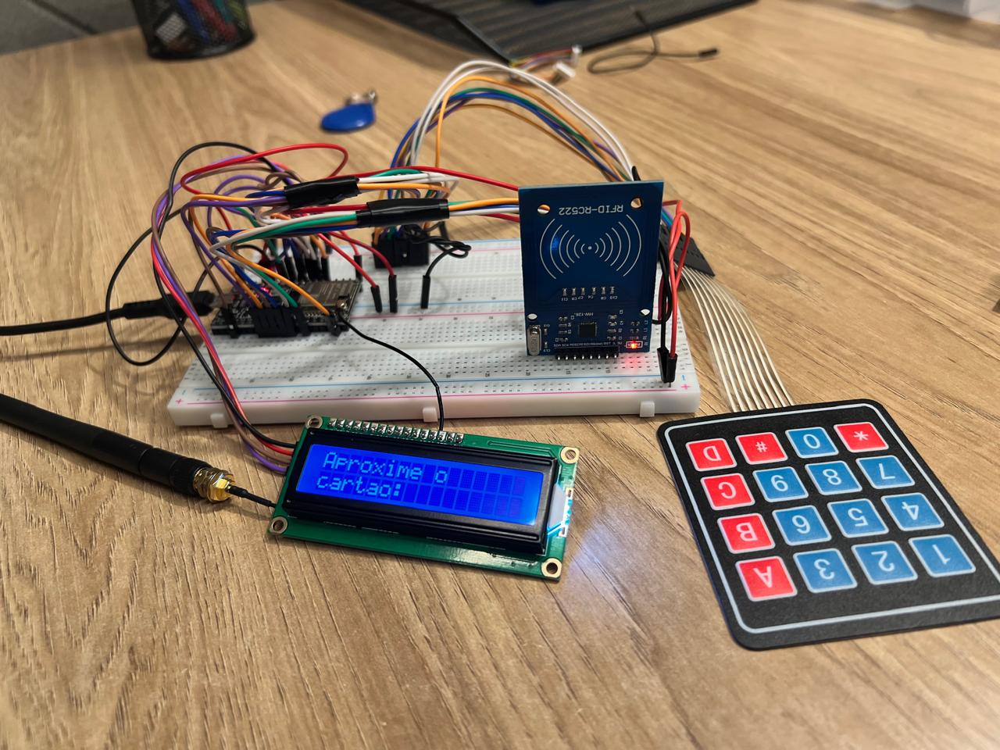
  <br>
  <em><sub><strong>Figura X:</strong> Vista geral do Módulo ESP32-SENHA com LCD, teclado e leitor RFID.</sub></em>
</p>

<br>

<p align="center">
  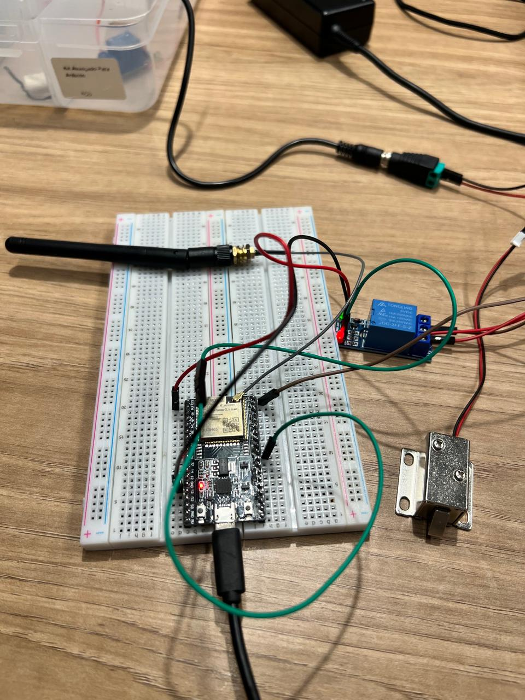
  <br>
  <em><sub><strong>Figura Y:</strong> Detalhe do Módulo ESP32-TRANCA conectado ao relé e à tranca física.</sub></em>
</p>

<br>

<p align="center">
  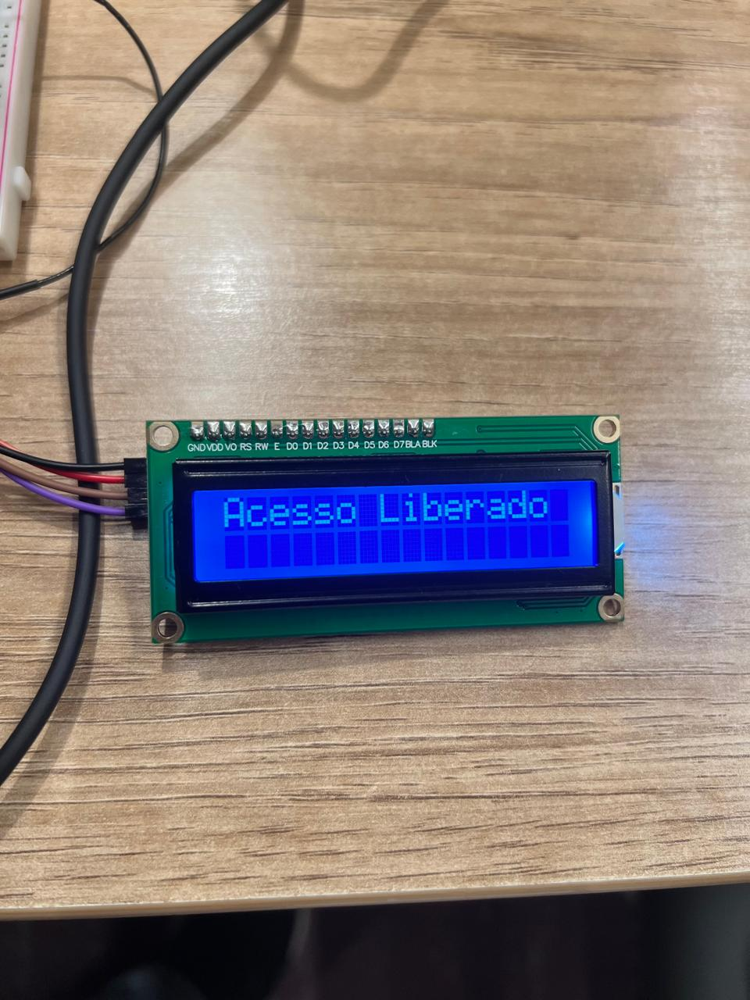
  <br>
  <em><sub><strong>Figura Z:</strong> Protótipo em ação, com o LCD exibindo "Acesso Liberado" durante o Teste 03.</sub></em>
</p>

#### **3.4.2.4 Vídeo de Demonstração do Protótipo**

Para uma demonstração visual da execução dos casos de teste (descritos na tabela a seguir) no protótipo físico, consulte o vídeo de validação no link abaixo:

**[VÍDEO DE DEMONSTRAÇÃO DOS TESTES](https://www.youtube.com/watch?v=RMs8XaUNUNU)**

#### **3.4.2.5 Cenários de Teste do Protótipo Físico**

&nbsp;&nbsp;&nbsp;&nbsp; Através dos casos de teste é possível verificar se um programa, sistema ou função está funcionando corretamente. Eles permitem testar diferentes situações e entradas para garantir que o comportamento esperado seja alcançado e que erros ou falhas sejam identificados antes que o software seja efetivamente utilizado.

&nbsp;&nbsp;&nbsp;&nbsp; A tabela a seguir detalha os testes executados para validar as "leituras (entradas)" (do RFID/Botão e Teclado) e as "escritas (saídas)" (no LCD, Buzzer e, mais importante, na Tranca).

| **#** | **Descrição** | **Pré-condição** | **Procedimento de teste** | **Pós-condição/Resultado esperado** | **Observações** (opcional) |
|---|---|---|---|---|---|
|01| Inicialização correta do sistema de controle de acesso | O dispositivo ESP32 está desligado e todos os componentes estão conectados corretamente | Ligue o dispositivo ESP32 e aguarde a inicialização completa do sistema | O LCD exibe "Aproxime o cartao" na primeira linha e fica aguardando a leitura do sensor RFID | Verifica se todos os componentes (LCD, teclado, sensor) inicializam corretamente |
|02| Detecção bem-sucedida de cartão RFID válido | Sistema inicializado e aguardando leitura de cartão (LCD mostra "Aproxime o cartao") | Pressione o botão verde que simula a leitura do cartão RFID | O LCD exibe "Digite a Senha:" e o sistema fica aguardando entrada de senha no teclado | No simulador, o botão verde substitui o leitor RFID real |
|03| Inserção de senha correta e liberação de acesso | Cartão foi detectado e sistema está aguardando senha (LCD mostra "Digite a Senha:") | Digite a senha correta "123456" no teclado matricial e pressione "#" para confirmar | O LCD exibe "Acesso Liberado". **A tranca física (conectada ao ESP32-TRANCA) recebe o comando MQTT e destrava a porta por 5 segundos.** O sistema retorna para "Aproxime o cartao". | Testa o fluxo completo de autenticação bem-sucedida e a "escrita (saída)" no atuador físico. |
|04| Inserção de senha incorreta e negação de acesso | Cartão foi detectado e sistema está aguardando senha (LCD mostra "Digite a Senha:") | Digite uma senha incorreta (ex: "654321") no teclado matricial e pressione "#" para confirmar | O LCD exibe "Acesso Negado". **A tranca física permanece travada.** **O buzzer (no ESP32-SENHA) emite um som de alerta.** O sistema retorna para "Aproxime o cartao". | Verifica a segurança do sistema e garante que o atuador (tranca) não seja acionado em caso de falha. |
|05| Visualização de senha mascarada durante digitação | Sistema aguardando entrada de senha | Digite alguns números no teclado (ex: "123") sem pressionar "#" | O LCD exibe "Digite a Senha:" na primeira linha e asteriscos (*) correspondentes aos dígitos digitados na segunda linha | Garante que a senha não seja visível durante a digitação |
|06| Correção de senha durante digitação usando tecla "*" | Sistema aguardando entrada de senha e já foram digitados alguns números | Digite alguns números, pressione "*" para apagar o último dígito, continue digitando | O último asterisco é removido do LCD e pode-se continuar digitando normalmente | Permite correção de erros during a digitação |
|07| Tentativa de acesso sem apresentar cartão primeiro | Sistema inicializado mostrando "Aproxime o cartao" | Tente digitar números no teclado sem antes pressionar o botão do cartão | O sistema não responde às teclas digitadas e mantém a mensagem "Aproxime o cartao" | Garante que o sistema só aceita senha após detectar cartão |
|08| Limite de caracteres na senha | Sistema aguardando entrada de senha | Digite mais de 6 números consecutivos no teclado | O sistema aceita apenas os primeiros 6 dígitos e ignora os demais | Previne overflow na entrada de senha |

&nbsp;&nbsp;&nbsp;&nbsp; Dessa forma, os casos de teste foram desenvolvidos para garantir a confiabilidade, segurança e funcionalidade do sistema de controle de acesso. Eles permitem verificar se todas as leituras (do RFID e teclado) e escritas (no LCD, buzzer e tranca) estão funcionando corretamente em diferentes cenários, desde o fluxo ideal de autenticação até situações de erro ou uso indevido. 

&nbsp;&nbsp;&nbsp;&nbsp; Além disso, asseguram que o sistema reage de forma previsível e segura, evitando que a tranca seja acionada sem autorização e que informações sensíveis, como a senha, sejam protegidas durante a digitação. 

#### **3.4.2.6 Trechos de Código Relevantes (Evidências)**

Os trechos de código a seguir ilustram como os casos de teste são executados, com foco na lógica de autenticação e na comunicação MQTT para acionar a saída física (tranca).

**A. Lógica de Autenticação e "Escrita (Saída)" (ESP32-SENHA)** Este trecho do Código 1 mostra a validação da senha (Testes 03 e 04) e a subsequente "escrita" (publicação MQTT) para o atuador.

```
// CODIGO 1: ESP32-SENHA
// ... (parte do loop() onde a tecla '#' é pressionada) ...

else if (tecla == '#') {
  lcd.clear();
  if (senha_digitada == senha_correta) { 
    // Validação do Teste 03 (Sucesso)
    lcd.print("Acesso Liberado");
    Serial.println("Senha correta!");
    client.publish("tranca", "liberada"); // <<-- ESCRITA (SAÍDA) LÓGICA
    
    // Feedback local no ESP-SENHA (não é a tranca principal)
    digitalWrite(tranca, HIGH); 
    delay(3000);
    digitalWrite(tranca, LOW);
    
    client.publish("tranca", "bloqueada"); // Comando para garantir o travamento
  
  } else {
    // Validação do Teste 04 (Falha)
    lcd.print("Acesso Negado");
    Serial.println("Senha incorreta!");
    
    // Feedback local no ESP-SENHA
    digitalWrite(buzzer, HIGH); // <<-- ESCRITA (SAÍDA) SONORA
    delay(500);
    // ... (buzzer bipa)
    digitalWrite(buzzer, LOW);
    
    client.publish("tranca", "bloqueada"); // Garante que a tranca permaneça bloqueada
  }
  
  // Reseta o estado para o Teste 01
  delay(2000);
  senha_digitada = "";
  sistemaAtivo = false;
  lcd.clear();
  lcd.print("Aproxime o"); // Volta à Pré-condição
  lcd.setCursor(0, 1);
  lcd.print("cartao:");
  return;
}
```

*   **Explicação:** Este código comprova os Testes 03 e 04. No sucesso, ele envia a mensagem liberada para o ESP32-TRANCA. Esta é a "escrita (saída)" lógica que o professor pediu, pois ela comanda o atuador físico. Em caso de falha, ele aciona o buzzer (outra "saída") e garante que a tranca receba o comando bloqueada.
    

**B. Recebimento e Acionamento da Tranca (ESP32-TRANCA)** Este trecho do Código 2 mostra o ESP32-TRANCA recebendo o comando e executando a "escrita (saída)" física.

```
// CODIGO 2: ESP32-TRANCA

// Constante para o pino do atuador (Nota: código tem pino 10 e 5)
const int saidaPin = 10; 

// ... (Setup do WiFi e MQTT) ...

void callback(char* topic, byte* payload, unsigned int length) {
  Serial.print("Mensagem recebida no tópico: ");
  Serial.println(topic);

  char payloadStr[length + 1];
  memcpy(payloadStr, payload, length);
  payloadStr[length] = '\0';

  if (strcmp(payloadStr, "liberada") == 0) {
    // Execução da Pós-condição do Teste 03
    digitalWrite(5, HIGH); // <<-- ESCRITA (SAÍDA) FÍSICA NA TRANCA
    delay(5000); // Mantém a tranca aberta por 5 segundos
    digitalWrite(5, LOW); // Trava a porta
  }
}

void reconnect() {
  while (!client.connected()) {
    // ... (Conecta ao MQTT)
    if (client.connect("ESP32ClientSub", mqtt_username, mqtt_password)) {
      client.subscribe("tranca"); // Assina o tópico
    }
    // ...
  }
}

void setup() {
  // ...
  pinMode(saidaPin, OUTPUT); // Configura o pino da tranca como saída
  // ...
  client.setCallback(callback);
}
```

*   **Explicação:** Este código é a evidência final do **Teste 03**. A função callback aguarda a mensagem "liberada". Ao recebê-la, ela imediatamente aciona o pino de saída (digitalWrite(5, HIGH)), que está conectado ao relé que controla a **tranca física**, por 5 segundos. Isso demonstra que a "escrita (saída)" no atuador foi testada e funciona.
    

#### **3.4.2.7 Conclusão da Validação do Protótipo Físico**

A implementação do protótipo físico com dois ESP32s e MQTT foi bem-sucedida, validando os requisitos fundamentais do projeto. A Tabela de Testes, em conjunto com os trechos de código e o vídeo de demonstração, comprova que o sistema é capaz de:

1.  **Ler Entradas:** Processar o fluxo de autenticação (RFID simulado + Teclado).
    
2.  **Escrever Saídas Informacionais:** Fornecer feedback claro ao usuário (LCD, Buzzer).
    
3.  **Escrever Saídas Físicas:** Comandar com sucesso a **tranca** (atuador) com base na lógica de autenticação.
    

Esta base de hardware offline é resiliente e modular, provando-se uma fundação sólida para a próxima fase do projeto, que incluirá a integração com o backend na nuvem e a lógica de agendamento.

### 3.4.3. Protótipo do Projeto com MQTT e I2C (sprint 3)	

_Aqui você deve registrar diversas situações de uso de seu sistema como um todo, indicando exemplos de ação do usuário e resposta do sistema, apontando como o ambiente deverá estar configurado para receber a ação e produzir a resposta. Estes registros serão utilizados para testar seu sistema, portanto, descreva várias situações, incluindo não apenas casos de sucesso, mas também de falha nos comportamentos do sistema. <br>
Siga as nomenclaturas e convenções já utilizadas anteriormente, e não se esqueça dos alinhamentos de negócios e experiência do usuário para pensar em situações representativas. Inclua figuras do protótipo físico e dashboards, além de descrições dos testes realizados para ilustrar o funcionamento do protótipo. A tabela a seguir serve como exemplo._

**#** | **Configuração do ambiente** | **Ação do usuário** | **Resposta esperada do sistema** 
|----------|----------|----------|----------|
|01|ex. precisa de um computador conectado na interface, dois ou mais dispositivos que simulem o posicionamento de um item X no espaço físico etc. | ex. usuário logado busca a localização do item X, que está ativo e operando normalmente | ex. interface do sistema acessa os dados da última localização registrada do item X e apresenta, constando local e horário de última atualização | 

### 3.4.4. Protótipo Físico do Projeto (online) (sprint 4)	

_Aqui você deve registrar diversas situações de uso de seu sistema como um todo, indicando exemplos de ação do usuário e resposta do sistema, apontando como o ambiente deverá estar configurado para receber a ação e produzir a resposta. Estes registros serão utilizados para testar seu sistema, portanto, descreva várias situações, incluindo não apenas casos de sucesso, mas também de falha nos comportamentos do sistema. <br>
**Desta vez, utilize diagramas de sequência UML para descrever os fluxos de teste do sistema.** <br>
Siga as nomenclaturas e convenções já utilizadas anteriormente, e não se esqueça dos alinhamentos de negócios e experiência do usuário para pensar em situações representativas. Inclua figuras do protótipo físico e dashboards, além de descrições dos testes realizados para ilustrar o funcionamento do protótipo._

### 3.4.5. Protótipo Final do Projeto (sprint 5)	

_Registre as situações de uso do sistema revisadas utilizando a modelagem UML para descrever os fluxos de teste. <br>
Também inclua figuras da versão final do protótipo físico e dashboards, além de descrições dos testes realizados para ilustrar o funcionamento do protótipo._

## <a name="c4"></a>4. Conclusões e Recomendações

_Escreva, de forma resumida, sobre os principais resultados do seu projeto e faça recomendações formais ao seu parceiro de projeto em relação ao uso dessa solução. Você pode aproveitar este espaço para comentar sobre possíveis materiais extras._

## <a name="c5"></a>5. Referências

**Fontes utilizadas na seção 3.1.1. Contexto da Indústria:**

**Sobre o Modelo de Concessão, Players e KPIs (Multas):**

GOVERNO DO BRASIL. ANTT. Manual de Fiscalização do Transporte Ferroviário. 4. ed. Brasília: ANTT, 2023. Disponível em: https://www.gov.br/antt/pt-br/assuntos/ferrovias/manuais-das-ferrovias/arquivos/manual-de-fiscalizacao-do-transporte-ferroviario-4a-edicao.pdf. Acesso em: 20 out. 2025.

MEIER, Ricardo. Governo confirma que CCR e Comporte disputarão concessão das linhas 11, 12 e 13 da CPTM. Metrô CPTM, 26 mar. 2025. Disponível em: https://www.metrocptm.com.br/governo-confirma-que-apenas-a-ccr-e-a-comporte-disputarao-concessao-das-linhas-11-12-e-13-da-cptm/. Acesso em: 20 out. 2025.

**Sobre as Tendências (Digitalização, IoT e Manutenção Preditiva):**

BLOG LYRA M2M. Como a IoT ajuda na manutenção preditiva em trens e linhas ferroviárias?. Lyra M2M, 9 jun. 2025. Disponível em: https://blog.lyram2m.com.br/como-a-iot-ajuda-na-manutencao-preditiva-em-trens-e-linhas-ferroviarias/. Acesso em: 20 out. 2025.

MODALCONNECTION. 3 tendências globais para o setor ferroviário. Intermodal Digital, 27 mar. 2025. Disponível em: https://modalconnection.com.br/eventos/ntexpo/3-tendencias-globais-para-o-setor-ferroviario/. Acesso em: 20 out. 2025.

**Sobre o Poder dos Fornecedores (Oligopólio):**

ALSTOM. Alstom celebra marco de 5 mil caixas produzidas no Brasil. Alstom (Press Release), 22 jul. 2024. Disponível em: https://www.alstom.com/pt/press-releases-news/2024/7/alstom-celebra-marco-de-5-mil-caixas-produzidas-no-brasil. Acesso em: 20 out. 2025.

**Sobre a Ameaça de Substitutos (Concorrentes SP-Campinas):**

BUSER. Ônibus de São Paulo - SP para Campinas - SP. Disponível em: https://www.buser.com.br/onibus/sao-paulo-sp/campinas-sp. Acesso em: 20 out. 2025.

VIAÇÃO COMETA. Passagem de Ônibus: Promoções Imperdíveis!. Disponível em: https://www.viacaocometa.com.br/. Acesso em: 20 out. 2025.


**Fontes utilizadas na seção 3.1.4. Value Proposition Canvas:**

**Value Proposition Canvas**

[2] RUSHIKEN, Amanda. (2023). Value Proposition Canvas: o que é e como funciona essa metodologia?. G4 Educação. Disponível em: <https://g4educacao.com/blog/value-proposition-canvas> Acesso em 21 out. 2025. <a name="foot2" id="foot2"></a>

**Sobre a pesquisa para as personas:**

TICTRENS. Vagas de emprego. Disponível em: https://tictrens.gupy.io/. Acesso em: 20 out. 2025